# ARCHITECTURE_IOT.md — Arsitektur Domain IoT, Edge & Telemetri VolatiSafe AIoT

> **DOMAIN:** 1 — Hardware, Edge Firmware & Telemetry  
> **PENANGGUNG JAWAB TEKNIS:** Hadi M. Hafiiz Hilmi (Hafiiz) — *IoT & Embedded Hardware Engineer*  
> **AREA AKSES (R/W):** `firmware/`, `simulation/wokwi/`, `docs/hardware/`  
> **CABANG GIT RESMI:** `iot`  
> **STATUS:** ARSITEKTUR DOMAIN IoT — penjelas operasional dari [`docs/universal/ARCHITECTURE.md`](../universal/ARCHITECTURE.md) (Lapis 1 & 2)

> **Sumber Kutipan (Single Source of Truth):**
> - [`docs/universal/ARCHITECTURE.md`](../universal/ARCHITECTURE.md) — topologi 4 lapis
> - [`docs/universal/INTERFACES.md`](../universal/INTERFACES.md) §1 — kontrak LoRa/MQTT
> - [`docs/universal/BOUNDARIES_AND_CONTRACTS.md`](../universal/BOUNDARIES_AND_CONTRACTS.md) — batasan domain & ACL
> - [`docs/universal/DECISIONS.md`](../universal/DECISIONS.md) — ADR 001–008
> - `docs/hardware/` — `FIRMWARE_SPEC.md`, `PINOUT_AND_SCHEMATICS.md`, `TELEMETRY_PAYLOAD.md`, `WOKWI_SIMULATION.md`
> - `docs/backend/` — `INGESTION_PIPELINE.md`, `DATABASE_SCHEMA.md`, `INTEGRATION.md`, `WEBSOCKET_AND_ALERTS.md`
> - `docs/ai/MODEL_SPEC.md`, `docs/digital_twin/` — `FAO56_WATER_BALANCE.md`, `FAILOVER_IMPUTATION.md`

---

## 1. Tujuan, Ruang Lingkup & Batasan Domain

> **Navigasi cepat (diagram alur):**
> - [§1.4 Peta Alur Besar — Grand Flow End-to-End](#14-peta-alur-besar--grand-flow-end-to-end-iot--backend--ai--frontend) — mulai di sini untuk gambaran menyeluruh
> - [§1.5A Kelangsungan Data Node](#a-kelangsungan-data-node-firmware--failover) · [§1.5B Gate Validasi](#b-gate-validasi-batas-fisik-backend-ingestion) · [§1.5C Failover Digital Twin](#c-failover-digital-twin-4-jendela-waktu) · [§1.5D Klasifikasi AVRI](#d-klasifikasi-avri--preskripsi--aksi) · [§1.5E Fallback AI](#e-fallback-inferensi-ai-ketahanan-sistem)
> - [§1.6 Legenda & Konvensi Diagram](#16-legenda--konvensi-diagram)

### 1.1 Tujuan Dokumen
Dokumen ini menjabarkan **arsitektur teknis domain IoT (Lapis 1 & 2)** VolatiSafe AIoT secara rinci: bagaimana node sensor lapangan dibangun, bagaimana firmware mengelola daya dan data, bagaimana gateway menerjemahkan paket LoRa, dan **bagaimana seluruh aliran ini terhubung ke Backend (Lapis 3) serta AI Engine tanpa melanggar batas domain.**

Dokumen universal [`ARCHITECTURE.md`](../universal/ARCHITECTURE.md) memberi gambaran makro 4 lapis; dokumen ini adalah **zoom** pada dua lapis terbawah (field node & gateway) beserta titik kontaknya.

### 1.2 Ruang Lingkup
- **Termasuk:** desain node fisik, pinout, manajemen daya, state machine firmware, kalibrasi edge, payload LoRa, gateway adapter, topologi MQTT, integrasi ke ingestion pipeline, dan titik serah-terima ke AI/Digital Twin.
- **Tidak termasuk:** implementasi model ML (domain AI), formulasi neraca air FAO-56 (domain Digital Twin), DDL tabel database (domain Backend), dan komponen UI (domain Frontend). Bagian tersebut dirujuk sebagai *titik integrasi*.

### 1.3 Batasan Mutlak Domain IoT (`BOUNDARIES_AND_CONTRACTS.md` §2.1)
| Aturan | Ketetapan |
|---|---|
| ✅ Boleh tulis | `firmware/`, `simulation/wokwi/`, `docs/hardware/` |
| ❌ Dilarang | Modifikasi FastAPI, skema TimescaleDB, model AI/ML, file UI frontend |
| ❌ Dilarang | Mengubah struktur payload LoRa tanpa koordinasi via `INTERFACES.md` §1 |
| 🔒 Aturan tetap | Node **tidak pernah** berkomunikasi langsung dengan frontend atau internet — hanya via LoRa ke gateway |

> **Hukum Utama (no bypassing):** `[IoT: Hafiiz] ⟶ LoRa ⟶ [Gateway] ⟶ MQTT ⟶ [Backend] ⟶ DTO ⟶ [AI]`. Node sensor tidak memiliki koneksi seluler/internet langsung (ADR 002).

### 1.4 Peta Alur Besar — Grand Flow End-to-End (IoT → Backend → AI → Frontend)

Diagram berikut adalah **peta orientasi 30 detik**: satu aliran tunggal yang menelusuri perjalanan data dari probe tanah di ladang hingga notifikasi WhatsApp di ponsel petani. Setiap lajur (*subgraph*) menandai **batas domain** dan siapa penanggung jawabnya.

```mermaid
flowchart TD
    START(["NODE BANGUN<br/>timer 15 menit"]) --> SAMPLING

    subgraph L1["LAPIS 1 · FIELD NODE — DOMAIN IoT (Hafiiz)"]
        direction TB
        SAMPLING["Sampling Burst<br/>GPIO25 HIGH · 5 sampel ADC<br/>+ DS18B20 · GPIO25 LOW"]
        CALIB["Edge Filtering & Kalibrasi<br/>median 5 sampel · %VWC · °C<br/>kompensasi pH kelembaban"]
        TX["LoRa TX<br/>payload JSON ≤ 52 byte<br/>433 MHz · SF7"]
        TXOK{"TX sukses?<br/>(max retry 3x)"}
        SLEEP["Deep Sleep 15 menit<br/>~10 µA · data siklus hilang"]
        SAMPLING --> CALIB --> TX --> TXOK
        TXOK -->|"gagal 3x"| SLEEP
    end

    TXOK -->|"ya · paket 52-byte"| RX

    subgraph L2["LAPIS 2 · GATEWAY & INGESTION — DOMAIN IoT (Hafiiz)"]
        direction TB
        RX["LoRa RX<br/>ESP32 / Raspberry Pi"]
        ACL["Anti-Corruption Adapter<br/>unpack → CleanTelemetryModel<br/>+ inject rssi_dbm · snr_db"]
        MQPUB["MQTT Publish<br/>/volatisafe/v1/node/id/telemetry"]
        RX --> ACL --> MQPUB
    end

    MQPUB -->|"Mosquitto :1883"| SUB

    subgraph L3B["LAPIS 3 · BACKEND — (Syifa)"]
        direction TB
        SUB["Ingestion Worker subscribe"]
        VALID{"validate_sensor_bounds()<br/>m 0-100 · t -10-60<br/>ph 3-10 · b 2.5-4.5"}
        DL["Dead-letter log<br/>status MALFUNCTION<br/>tidak panggil AI"]
        INSERT["INSERT hypertable<br/>telemetry (TimescaleDB)"]
        STATE["Update field_state<br/>Digital Twin 15 menit"]
        FEAT["Feature Assembly<br/>soil state + cuaca BMKG 12 jam"]
        SUB --> VALID
        VALID -->|"tidak valid"| DL
        VALID -->|"valid"| INSERT --> STATE --> FEAT
    end

    FEAT --> DROPOUT

    subgraph L3AI["LAPIS 3 · DIGITAL TWIN & AI — (Andharu & Aris)"]
        direction TB
        DROPOUT{"Sensor dropout?<br/>last_seen > 30 menit"}
        IMPUTE["Failover Imputation<br/>FAO-56 + difusi termal<br/>is_predicted = true"]
        PIML["PIML Inferensi<br/>LightGBM residual + kinetika urease<br/>→ AVRI 0-100% + TreeSHAP"]
        AIFAIL{"Inferensi AI<br/>berhasil?"}
        FBACK["Fallback Fisika Dasar<br/>T>32°C & M<25% → AVRI 80%"]
        DROPOUT -->|"ya"| IMPUTE --> PIML
        DROPOUT -->|"tidak · data live"| PIML
        PIML --> AIFAIL
        AIFAIL -->|"gagal / outlier"| FBACK
    end

    AIFAIL -->|"sukses"| WS
    FBACK --> WS

    subgraph L4["LAPIS 4 · PRESENTATION & ALERTING — (Syifa)"]
        direction TB
        WS["WebSocket broadcast<br/>event TELEMETRY_UPDATE"]
        DASH["Dashboard Next.js PWA<br/>banner AVRI · grafik · peta petak"]
        AVRIDEC{"AVRI > 60%?<br/>(Kritis / Bahaya)"}
        ALERT["Alert WhatsApp / Telegram<br/>preskripsi + jendela aman"]
        WS --> DASH --> AVRIDEC
        AVRIDEC -->|"ya"| ALERT
    end

    ALERT --> PETANI(["Petani menerima<br/>notifikasi di HP"])
    AVRIDEC -->|"tidak · aman/waspada"| PETANI2(["Dashboard menampilkan<br/>waktu aman menabur"])
    SLEEP -.->|"siklus berikutnya"| START

    %% Legenda warna domain
    classDef iot fill:#E6FFFA,stroke:#0D9488,stroke-width:2px,color:#134E4A
    classDef backend fill:#EAF0F8,stroke:#1D4E89,stroke-width:2px,color:#0B2545
    classDef ai fill:#FEF9C3,stroke:#CA8A04,stroke-width:2px,color:#713F12
    classDef front fill:#F1F5F9,stroke:#475569,stroke-width:2px,color:#0F172A
    classDef err fill:#FEE2E2,stroke:#DC2626,stroke-width:2px,color:#991B1B
    classDef term fill:#0D9488,stroke:#0F766E,color:#FFFFFF
    class SAMPLING,CALIB,TX,RX,ACL,MQPUB iot
    class SUB,INSERT,STATE,FEAT backend
    class IMPUTE,PIML ai
    class WS,DASH,ALERT front
    class DL,FBACK err
    class START,PETANI,PETANI2,SLEEP term
```

**Cara membaca diagram ini (ringkas):**
1. **Lapis 1 (IoT)** memproduksi data mentah — proses berulang setiap 15 menit, dan bila LoRa gagal 3x, node tidur tanpa data (celah ditangani Lapis 3).
2. **Lapis 2 (IoT/Gateway)** menerjemahkan paket ringkas LoRa menjadi `CleanTelemetryModel` — batas domain IoT berakhir di sini.
3. **Lapis 3 (Backend)** memvalidasi batas fisik, menyimpan, dan menyusun fitur; **AI/Twin** mengimputasi dropout lalu menghitung AVRI + TreeSHAP.
4. **Lapis 4 (Frontend)** menyiarkan live ke dashboard dan memicu alert ketika AVRI melewati ambang Kritis (> 60%).

### 1.5 Flowchart Keputusan Kritis (Decision Map)

Lima titik cabang logika yang menentukan perilaku sistem. Semuanya dikutip langsung dari kontrak teknis repo.

#### A. Kelangsungan Data Node (Firmware ↔ Failover)

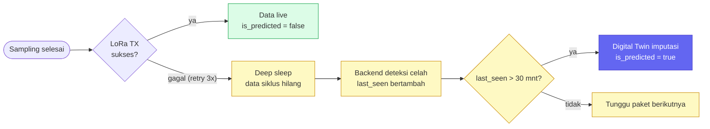

#### B. Gate Validasi Batas Fisik (Backend Ingestion)

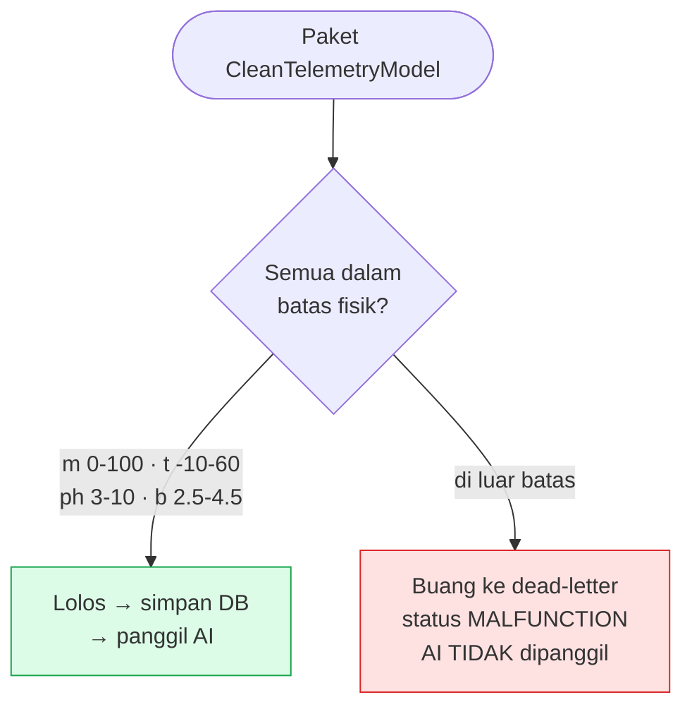

#### C. Failover Digital Twin (4 Jendela Waktu)

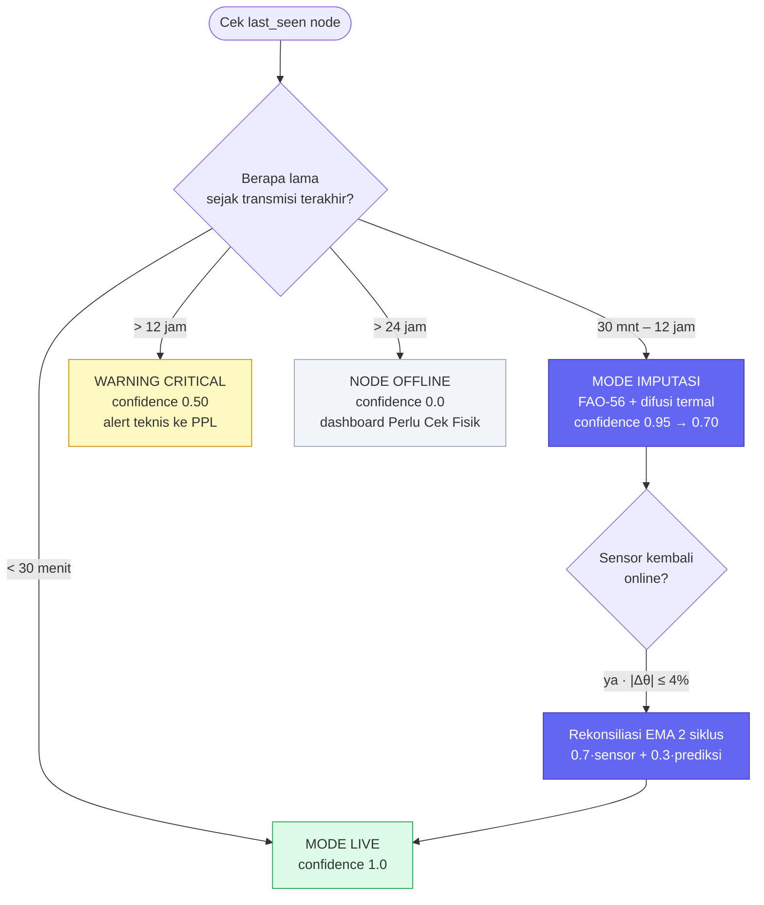

#### D. Klasifikasi AVRI → Preskripsi & Aksi

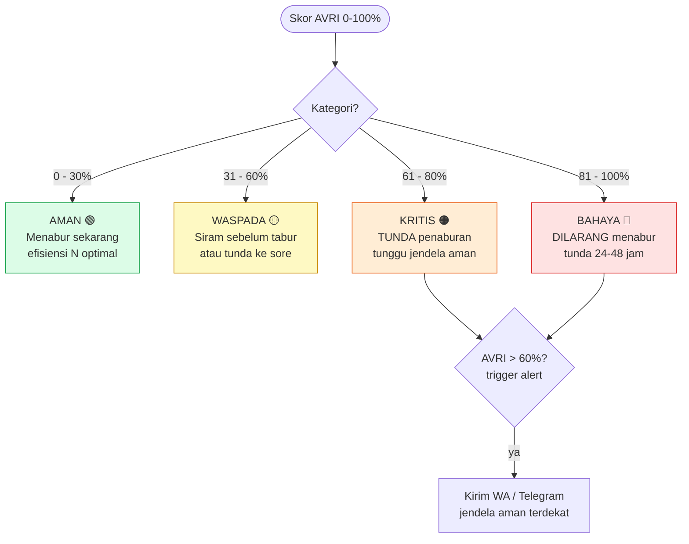

#### E. Fallback Inferensi AI (Ketahanan Sistem)

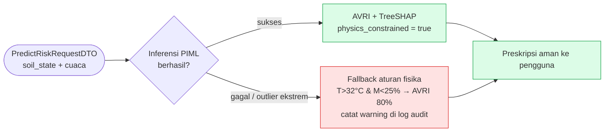

### 1.6 Legenda & Konvensi Diagram

| Elemen | Bentuk / Warna | Makna |
|---|---|---|
| **Field / IoT** | Kotak, latar Teal `#E6FFFA` | Lapis 1 & 2 — firmware, node, gateway (Hafiiz) |
| **Backend** | Kotak, latar Navy muda `#EAF0F8` | Ingesti, DB, feature assembly (Syifa) |
| **AI / Digital Twin** | Kotak, latar Kuning `#FEF9C3` | Imputasi, inferensi PIML, TreeSHAP (Andharu & Aris) |
| **Frontend** | Kotak, latar Slate `#F1F5F9` | Dashboard, WebSocket, bot (Syifa) |
| **Error / Fallback** | Kotak, latar Merah `#FEE2E2` | dead-letter, fallback fisika |
| **Keputusan** | Belah ketupat `{...}` | Cabang logika (TX sukses?, bounds valid?, AVRI>60%?) |
| **Terminal / Terminal State** | Stadium `([...])` | Mulai/selesai, aksi pengguna, deep sleep |
| **Database** | — | Direpresentasikan sebagai kotak proses berlabel `INSERT`/`hypertable` |

> **Konvensi:** Setiap `classDef` di seluruh dokumen konsisten — Teal=Navy untuk domain IoT/backend, Kuning untuk AI, Slate untuk frontend, Merah untuk jalur gagal. Diagram Mermaid dapat dirender langsung di GitHub, VS Code, atau preview Markdown.

---

## 2. Posisi Domain IoT dalam Arsitektur 4 Lapis

```
┌─────────────────────────────────────────────────────────────────────────────┐
│ LAPIS 1 — FIELD NODE (Edge Sensing & Battery Management)   ◄── DOMAIN IoT   │
│  ESP32 MCU + Capacitive Soil Moisture v1.2 + DS18B20 Temp + Analog pH      │
│  Deep Sleep 15 menit · Burst Sampling 5x · MOSFET Power Gate (Anti-Korosi)  │
└──────────────────────────────────────┬──────────────────────────────────────┘
                                       │ LoRa 433 MHz (SX1278, Jarak 2–5 km)
┌──────────────────────────────────────▼──────────────────────────────────────┐
│ LAPIS 2 — GATEWAY & INGESTION ADAPTER                      ◄── DOMAIN IoT   │
│  ESP32 / Raspberry Pi LoRa RX + WiFi/Ethernet · Mosquitto MQTT Broker       │
│  Anti-Corruption Adapter (Unpack Payload → Clean Telemetry Model)          │
└──────────────────────────────────────┬──────────────────────────────────────┘
                                       │ Ingestion Pipeline (MQTT / Internal Bus)
┌──────────────────────────────────────▼──────────────────────────────────────┐
│ LAPIS 3 — AGRO-CLIMATIC DIGITAL TWIN & AI ENGINE         ◄── DIG.TWIN & AI  │
│  FAO-56 Water Balance · Thermal Diffusion · LightGBM PIML · TreeSHAP        │
│  Storage: TimescaleDB (Hypertable) & PostgreSQL (State/Metadata)            │
└──────────────────────────────────────┬──────────────────────────────────────┘
                                       │ REST API (JSON) / WebSocket Live Stream
┌──────────────────────────────────────▼──────────────────────────────────────┐
│ LAPIS 4 — PRESENTATION & ALERTING LAYER                    ◄── FRONTEND     │
│  Next.js 14 PWA · Leaflet · Recharts · WhatsApp/Telegram Bot                │
└─────────────────────────────────────────────────────────────────────────────┘
```

**Tanggung jawab domain IoT berhenti di titik:** gateway memublikasikan `CleanTelemetryModel` ke MQTT. Setelah itu, kendali berpindah ke Backend (Lapis 3).

### 2.1 Diagram Alir 4 Lapis (Mermaid)

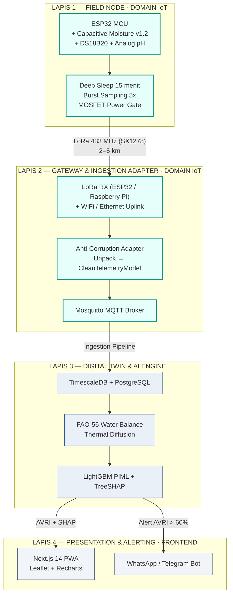

---

## 3. Arsitektur Fisik Node Lapangan (Lapis 1)

### 3.1 Block Diagram Node

```
                    ┌──────────────────────────────────────┐
                    │          PANEL SURYA 5V 1W           │
                    │     (Polycrystalline + Dioda 1N4007) │
                    └──────────────────┬───────────────────┘
                                       │
                    ┌──────────────────▼───────────────────┐
                    │   TP4056 Charger + DW01 Protection   │
                    └──────────────────┬───────────────────┘
                                       │
                    ┌──────────────────▼───────────────────┐
                    │      BATERAI Li-ion 18650 2600mAh     │
                    └──────────────────┬───────────────────┘
                                       │ +3.7V
      ┌────────────────────────────────┼─────────────────────────────┐
      │                                │                             │
      ▼                                ▼                             ▼
┌──────────────┐            ┌───────────────────┐          ┌──────────────────┐
│  ESP32       │            │  MOSFET Power Gate│          │  Voltage Divider │
│  WROOM-32D  │◄── GPIO25 ─┤  (IRLZ44N/AO3401) │          │ 100kΩ / 100kΩ    │
│  modul       │            └─────────┬─────────┘          └────────┬─────────┘
│  Dual Core   │                      │ Switched VCC                │
│  240 MHz     │            ┌─────────┴───────────┐                 │ GPIO35 (ADC1_CH7)
│              │            │  Capacitive Moist.  │                 │
│              │◄── GPIO34 ─┤  v1.2 (ADC1_CH6)    │                 │
│              │◄── GPIO32 ─┤  pH Module (ADC1_CH4)│                │
│              │◄── GPIO4 ──┤  DS18B20 1-Wire     │                 │
│              │            └─────────────────────┘                 │
│              │◄────────────────────────────────────────────────┘
│              │
│              │  SPI (GPIO 18/19/23/5/14/2)
│              ▼
┌──────────────────────────────┐
│  LoRa SX1278 Ra-02 433 MHz   │
│  + Antena Helikal Spring     │
└──────────────┬───────────────┘
               │ 433 MHz (SF7, BW 125 kHz, +17 dBm)
               ▼
        ═══════════════► ke Gateway (2–5 km)
```

### 3.1.1 Block Diagram Node (Mermaid)

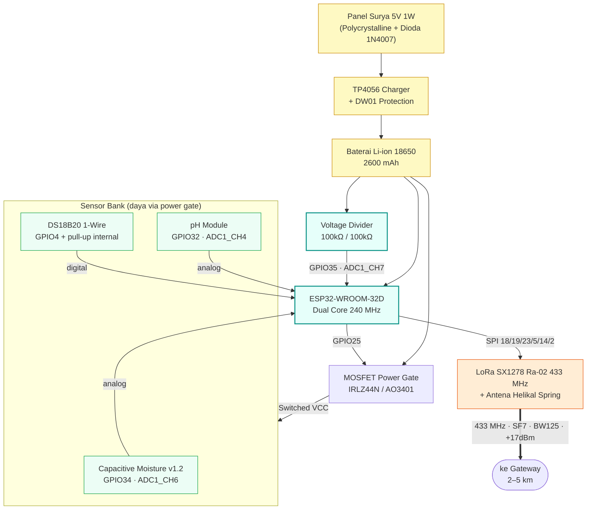

### 3.2 Pemetaan Pin ESP32-WROOM-32D

> ⚠️ **PERINGATAN ADC:** Sensor analog **WAJIB** di pin **ADC1** (GPIO 32–39). Pin ADC2 (GPIO 0, 2, 4, 12–15, 25–27) terkunci saat radio WiFi aktif.

| Komponen / Sensor | Pin ESP32 | Tipe Sinyal | Rangkaian Tambahan |
|---|---|---|---|
| **Capacitive Moisture v1.2 (SIG)** | **GPIO 34** | Analog (ADC1_CH6) | Tegangan 1.2V–2.8V (input-only) |
| **Soil pH Sensor (SIG)** | **GPIO 32** | Analog (ADC1_CH4) | Simulasi Wokwi; hardware pH belum ada |
| **DS18B20 Suhu Probe (DATA)** | **GPIO 4** | Digital (1-Wire) | **Tanpa resistor eksternal**, pull-up internal `INPUT_PULLUP` |
| **Micro SD (CS)** | **GPIO 5** | SPI CS | Buffer store-and-forward; bentrok CS LoRa |
| **Micro SD (SCK/MISO/MOSI)** | **18/19/23** | SPI | Bus SPI hardware |
| **MOSFET Sensor VCC Gate** | **GPIO 25** | Digital Output | HIGH=ON, LOW=SLEEP (belum dirakit) |
| **LoRa SX1278 (SCK)** | **GPIO 18** | SPI Clock | Belum terpasang |
| **LoRa SX1278 (MISO)** | **GPIO 19** | SPI MISO | Belum terpasang |
| **LoRa SX1278 (MOSI)** | **GPIO 23** | SPI MOSI | Belum terpasang |
| **LoRa SX1278 (NSS/CS)** | **GPIO 5** | Digital Output | Belum terpasang; pindahkan CS sebelum dipakai |
| **LoRa SX1278 (RESET)** | **GPIO 14** | Digital Output | Belum terpasang |
| **LoRa SX1278 (DIO0)** | **GPIO 2** | Interrupt Input | Belum terpasang |
| **Sensor Tegangan Baterai** | **GPIO 35** | Analog (ADC1_CH7) | Belum terpasang; firmware kirim placeholder 3,87 V |

### 3.3 Power Gate Anti-Korosi (Failover Daya)

Prinsip kerja (mencegah korosi elektrolisis probe di tanah basah & menghemat daya):

```
GPIO25 HIGH  ──> MOSFET ON  ──> Switched VCC ──> Sensor menyala
                                 │ delay(200) ms stabilisasi tegangan
                                 │ sampling burst 5x
GPIO25 LOW   ──> MOSFET OFF ──> VCC sensor terputus total
                                 │ ESP32 masuk ESP.deepSleep()
```

- Saat *deep sleep* (99% waktu), VCC sensor terputus total → arus bocor nol.
- Modul LoRa juga dimatikan (*sleep mode*) sebelum ESP32 tidur.

### 3.4 Bill of Materials (BoM) per Node

| # | Komponen | Spesifikasi | Qty | Estimasi Harga |
|---|---|---|---|---|
| 1 | ESP32-WROOM-32D | Modul WROOM-32D, Dual Core 240 MHz | 1 | Rp55.000 |
| 2 | Capacitive Soil Moisture v1.2 | Anti-korosi | 1 | Rp15.000 |
| 3 | DS18B20 Probe | Stainless waterproof 1m | 1 | Rp18.000 |
| 4 | Modul pH + Probe BNC | Analog pH lapangan (belum ada, simulasi Wokwi) | 1 | Rp62.000 |
| 5 | LoRa SX1278 Ra-02 | 433 MHz + antena helikal | 1 | Rp45.000 |
| 6 | Baterai Li-ion 18650 | 2600 mAh 3.7V + Holder | 1 | Rp35.000 |
| 7 | Charger TP4056 | + proteksi DW01 | 1 | Rp6.000 |
| 8 | Panel Surya Mini | 5V 1W + Dioda 1N4007 | 1 | Rp25.000 |
| 9 | MOSFET | IRLZ44N / AO3401 | 1 | Rp4.000 |
| 10 | Enclosure | Box PVC IP65 tahan UV | 1 | Rp30.000 |
| 11 | Housing Probe | Pipa PVC ¾ inch | 1 | Rp10.000 |
| 12 | Modul Micro SD | SPI 3,3 V + kartu micro SD | 1 | Rp15.000 |
| | **TOTAL PER NODE** | | | **± Rp305.000** |

---

## 4. Arsitektur Firmware & Manajemen Daya (Lapis 1)

### 4.1 State Machine Siklus Hidup (Sleep-Wake 15 Menit)

```
[ TIMER WAKEUP ] (Setiap 15 Menit)
       │
       ▼
[ WAKEUP & INIT ]
 • Serial 115200 baud
 • Baca kalibrasi dari Flash NVS (DryADC, WetADC, pHSlope, pHNeutralADC)
 • Init SPI & LoRa SX1278 (433.0 MHz, SF7, BW 125kHz)
       │
       ▼
[ SENSOR SAMPLING BURST ]
 • GPIO25 HIGH ──> MOSFET ON (sensor menyala)
 • delay(200 ms) stabilisasi
 • Ambil 5 sampel ADC GPIO34 (Kelembaban) & GPIO32 (pH)
 • Baca DS18B20 via 1-Wire GPIO4
 • GPIO25 LOW ──> VCC sensor terputus
       │
       ▼
[ EDGE FILTERING & KALIBRASI ]
 • Median dari 5 sampel (buang noise spike)
 • Konversi ADC → % VWC & °C
 • Kompensasi pH dinamis terhadap kelembaban
 • Ukur voltase baterai via GPIO35 (divider)
       │
       ▼
[ LORA TRANSMISSION ]
 • Susun payload kompak JSON (≤ 52 byte)
 • Kirim LoRa SX1278 (max retry 3x, jeda 2 detik)
       │
       ▼
[ DEEP SLEEP START ]
 • Timer 15 menit (15×60×1.000.000 µs)
 • Matikan modul radio
 • ESP.deepSleep() (~10 µA)
```

### 4.1.1 State Machine Siklus Hidup (Mermaid)

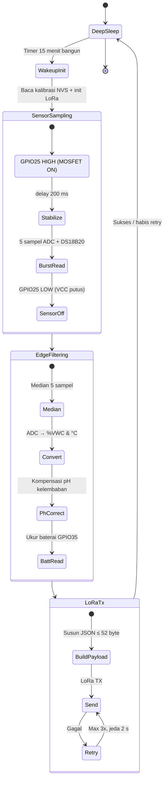

### 4.2 Rumus Kalibrasi Edge

**Kelembaban Kapasitif:**
```cpp
// dryADC ~2800 (udara kering), wetADC ~1350 (tanah jenuh)
float moisture_pct = (float)(dryADC - moisture_median) / (dryADC - wetADC) * 100.0;
moisture_pct = constrain(moisture_pct, 0.0, 100.0);
```

**Koreksi pH terhadap Kelembaban (edge preprocessing):**
```cpp
float ph_raw = 7.0 - ((ph_median - ph_neutral_adc) / ph_slope);
// Saat tanah kering (<50%), probe cenderung terbaca lebih asam
float ph_corrected = ph_raw + (0.15 * (50.0 - moisture_pct) / 50.0);
ph_corrected = constrain(ph_corrected, 3.0, 10.0);
```

**Suhu DS18B20:** Library `OneWire` + `DallasTemperature`. Rentang valid −10°C s/d +60°C. Jika terputus (terbaca −127°C), firmware menandai `t: -999` (sensor error).

### 4.3 Power Budget Analysis

| Fase Operasi | Arus | Durasi/Siklus | Konsumsi/Siklus |
|---|---|---|---|
| Deep Sleep | 10 µA | 897 detik | 0,0025 mAh |
| Sensor Aktif (MOSFET ON) | 15 mA | 1 detik | 0,0042 mAh |
| Transmisi LoRa SX1278 (+17dBm) | 120 mA | 0,5 detik | 0,0167 mAh |
| Overhead Komputasi & ADC | 80 mA | 1,5 detik | 0,0333 mAh |
| **TOTAL PER SIKLUS (15 mnt)** | — | **900 detik** | **≈ 0,0567 mAh** |
| **TOTAL PER HARI (96 siklus)** | — | — | **≈ 5,44 mAh/hari** |

**Estimasi Ketahanan:**
- Teoritis: 2600 mAh / 5,44 mAh/hari ≈ **477 hari**.
- Realistis (efisiensi 60% + degradasi dingin): **90–120 hari** tanpa isi ulang.
- + Panel surya 1W (100–150 mAh/hari saat terik) → **zero-maintenance** sepanjang siklus jagung (100–120 hari).

### 4.4 Perilaku Kegagalan Firmware
- Jika transmisi gagal setelah **3x retry**, node **tetap** masuk deep sleep (tidak menguras baterai).
- Payload yang gagal dikirim disimpan ke **buffer micro SD (NDJSON)** dan dikirim ulang pada siklus berikutnya sebelum payload baru, sehingga urutan waktu di backend tidak tertukar. Bila antrian penuh (200 baris) atau kartu tidak ada, data siklus itu hilang dan celahnya ditangani **failover Digital Twin** di Lapis 3 (§9).

---

## 5. Arsitektur Gateway & Ingestion Adapter (Lapis 2)

### 5.1 Topologi Gateway

```
   [ Node A ]──┐
   [ Node B ]──┤  LoRa 433 MHz      ┌─────────────────────────────────┐
   [ Node C ]──┼──────────────────► │  LoRa RX (ESP32 / Raspberry Pi) │
   [ Node N ]──┘   (2–5 km)          │  + WiFi / Ethernet uplink        │
                                     └────────────────┬────────────────┘
                                                      │ (ACL: unpack payload)
                                     ┌────────────────▼────────────────┐
                                     │  Mosquitto MQTT Broker          │
                                     │  localhost:1883                 │
                                     └────────────────┬────────────────┘
                                                      │
                                     ┌────────────────▼────────────────┐
                                     │  Ingestion Worker (FastAPI/async)│
                                     │  → Lapis 3 (Backend/AI)          │
                                     └─────────────────────────────────┘
```

### 5.1.1 Topologi Gateway (Mermaid)

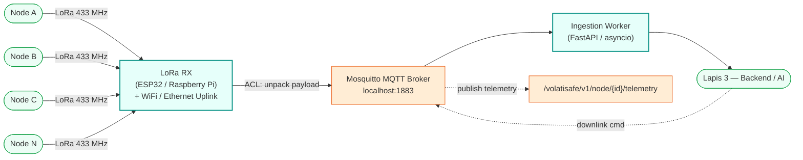

### 5.2 Topik MQTT Standar (`INTERFACES.md` §1.1)

| Topik | Publisher | Fungsi |
|---|---|---|
| `/volatisafe/v1/node/{node_id}/telemetry` | Gateway | Publikasi telemetri node |
| `/volatisafe/v1/gateway/{gateway_id}/status` | Gateway | Status gateway (LWT — Last Will Testament) |
| `/volatisafe/v1/node/{node_id}/downlink` | Backend | Perintah konfigurasi ke node |

### 5.3 Anti-Corruption Layer (ACL) — `lora_adapter.py`

ACL mengisolasi Backend dari struktur byte LoRa. Semua data yang keluar gateway sudah dinormalisasi ke `CleanTelemetryModel`.

```python
# File: backend/app/adapters/lora_adapter.py
from datetime import datetime, timezone
from pydantic import BaseModel, Field

class CleanTelemetryModel(BaseModel):
    node_id: str
    recorded_at: datetime
    moisture_pct: float = Field(ge=0.0, le=100.0)
    soil_temp_c: float = Field(ge=-10.0, le=60.0)
    ph: float = Field(ge=3.0, le=10.0)
    battery_voltage: float = Field(ge=2.5, le=4.5)
    is_predicted: bool = False

def unpack_lora_payload(raw_json: dict) -> CleanTelemetryModel:
    """Jika Hardware mengubah nama key di firmware, HANYA fungsi ini diperbarui."""
    return CleanTelemetryModel(
        node_id=str(raw_json["n"]),
        recorded_at=datetime.fromtimestamp(int(raw_json["ts"]), tz=timezone.utc),
        moisture_pct=round(float(raw_json["m"]), 1),
        soil_temp_c=round(float(raw_json["t"]), 1),
        ph=round(float(raw_json["ph"]), 2),
        battery_voltage=round(float(raw_json["b"]), 2),
        is_predicted=False,
    )
```

> **Decoupling Buffer:** Mengganti sensor (mis. pH analog → RS485 Modbus) hanya perlu memperbarui `lora_adapter.py`. AI Engine & Frontend tidak terpengaruh (`BOUNDARIES_AND_CONTRACTS.md` §3.1, §4 Skenario 1).

---

## 6. Kontrak Data Hardware ↔ Backend (LoRa/MQTT Boundary)

### 6.1 Payload LoRa Kompak (≤ 52 Byte)

```json
{"n":"VS-A1-003","ts":1792934400,"m":22.4,"t":34.1,"ph":7.83,"b":3.87}
```

| Key | Tipe | Bytes | Rentang Fisik | Satuan | Deskripsi |
|---|---|---|---|---|---|
| `n` | String | 9 | 6–12 char | — | Node ID fisik |
| `ts` | Int32 | 10 | ≥ 1700000000 | detik | Unix timestamp sampling |
| `m` | Float | 4 | 0.0 – 100.0 | % VWC | Kelembaban tanah kapasitif terkalibrasi |
| `t` | Float | 4 | −10.0 – 60.0 | °C | Suhu tanah DS18B20 |
| `ph` | Float | 4 | 3.00 – 10.00 | — | pH tanah terkoreksi kelembaban |
| `b` | Float | 4 | 2.80 – 4.25 | Volt | Tegangan baterai 18650 |
| **Total** | — | **~52** | — | — | Muat 1 paket LoRa SF7 |

### 6.2 Opsi Biner Terpadu (13 Byte — untuk SF10–SF12 > 4 km)

```
Byte 0..3   : Node ID (UInt32 numeric hash)
Byte 4..7   : Timestamp Unix Epoch (UInt32)
Byte 8      : Moisture x 2 (UInt8: 0..200 → 0.0–100.0%)
Byte 9..10  : Temperature (Int16: suhu * 10, 341 → 34.1°C)
Byte 11     : pH x 10 (UInt8: 0..140 → pH 0.0–14.0)
Byte 12     : Battery Voltage (UInt8: (Volt - 2.5) * 100)
```

### 6.3 Payload Telemetri Bersih (Gateway → Backend)

```json
{
  "node_id": "VS-A1-003",
  "recorded_at": "2026-10-24T16:00:00Z",
  "moisture_pct": 22.4,
  "soil_temp_c": 34.1,
  "ph": 7.83,
  "battery_voltage": 3.87,
  "rssi_dbm": -82,
  "snr_db": 9.5,
  "is_predicted": false
}
```

> **Compression note:** Payload LoRa 52-byte menyimpan `n`,`ts`,`m`,`t`,`ph`,`b`. `rssi_dbm` & `snr_db` di-inject oleh gateway dari metadata radio saat RX (bukan dikirim node). `is_predicted` default `false`.

---

## 7. Aliran Data End-to-End (8 Langkah)

```
1. Sensor Read ──> 2. LoRa TX ──> 3. Gateway Adapter ──> 4. TimescaleDB Ingestion
                                                                   │
                                                                   ▼
8. WhatsApp / ◄── 7. WebSocket / ◄── 6. Prediction ◄── 5. Feature Assembly
   Telegram Bot      REST API            (AVRI + SHAP)    (Soil State + Weather)
   ▲ LAPIS 4                                        ▲ LAPIS 3 (Backend + AI)
   └─────────────────── LAPIS 1 & 2 (IoT) berakhir di langkah 3 ─────┘
```

### 7.0 Diagram Aliran Data End-to-End (Mermaid)

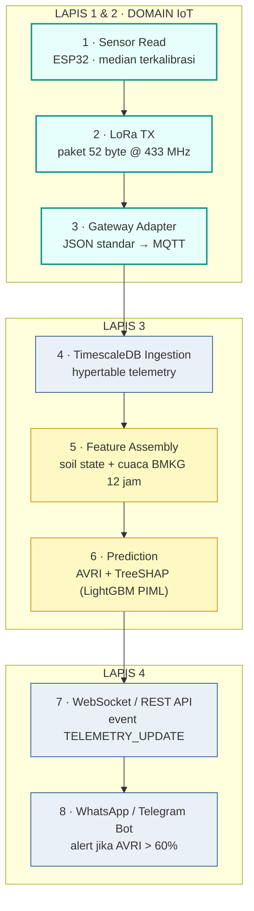

| # | Langkah | Domain | Detail |
|---|---|---|---|
| 1 | Sampling | **IoT** | ESP32 nyalakan MOSFET, 5 sampel/sensor, median terkalibrasi, MOSFET OFF |
| 2 | LoRa Transmit | **IoT** | Paket 52-byte pada 433 MHz |
| 3 | Gateway Ingestion | **IoT** | Terima paket → JSON standar → publish MQTT `/volatisafe/v1/node/{id}/telemetry` |
| 4 | Penyimpanan | Backend | Ingestion worker simpan ke TimescaleDB hypertable `telemetry` |
| 5 | Feature Assembly | Backend | Gabungkan soil state + prakiraan cuaca BMKG 12 jam |
| 6 | Inferensi AI | AI Engine | LightGBM + PIML hitung AVRI, kategori risiko, TreeSHAP |
| 7 | Penyajian Real-Time | Backend | Event `TELEMETRY_UPDATE` via WebSocket ke dashboard Next.js |
| 8 | Peringatan Otomatis | Backend | WhatsApp/Telegram bot jika AVRI > 60% (Kritis/Bahaya) |

---

## 8. Integrasi ke Backend (Lapis 3 — Ingesti & Penyimpanan)

### 8.1 Pipeline Ingesti Asinkron (6 Step)

```
[ Node / Wokwi ] ──LoRa/TCP──► [ Gateway / MQTT Bridge ]
                                        │ publish
                                        ▼
                            [ Mosquitto MQTT Broker :1883 ]
                                        │ async subscribe
                                        ▼
                            [ Ingestion Worker (FastAPI/asyncio) ]
                             ├── Step 1: Validasi Integritas & Filter Anomali
                             ├── Step 2: Unpack via lora_adapter.py (ACL)
                             ├── Step 3: Insert Hypertable TimescaleDB (telemetry)
                             ├── Step 4: Trigger update State Digital Twin
                             ├── Step 5: Inferensi AI (AVRI + TreeSHAP)
                             └── Step 6: Siarkan WebSocket & Trigger Alert jika Kritis
```

### 8.1.1 Pipeline Ingesti (Mermaid)

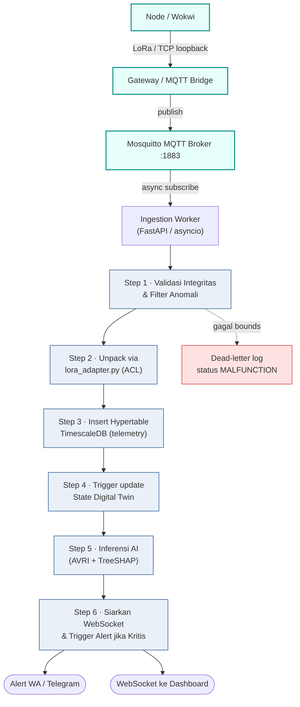

### 8.2 Sanity Check Batas Fisik (Gate Anomali)

```python
def validate_sensor_bounds(m, t, ph, b) -> bool:
    if not (0.0 <= m <= 100.0):  return False
    if not (-10.0 <= t <= 60.0): return False
    if not (3.0 <= ph <= 10.0):  return False
    if not (2.5 <= b <= 4.5):    return False
    return True
```

- Paket gagal → dibuang ke log *dead-letter* + status sensor **"MALFUNCTION"**; **tidak** memicu kalkulasi AI.
- Ini adalah lapisan pertahanan pertama yang melindungi AI Engine dari input tak wajar.

### 8.3 Tabel Persistensi Terkait IoT (`DATABASE_SCHEMA.md`)

| Tabel | Peran di aliran IoT | Kolom kunci |
|---|---|---|
| `nodes` | Registrasi perangkat ESP32 | `node_id`, `field_id`, `firmware_ver`, `battery_v`, `last_seen` |
| `telemetry` (Hypertable) | Data mentah sensor (partisi 7 hari) | `ts`, `node_id`, `moisture`, `soil_temp`, `ph`, `battery_v`, `rssi_dbm`, `is_predicted` |
| `field_state` | State vektor Digital Twin | `theta`, `t_soil`, `ph`, `et0_today`, `dat` |
| `data_provenance` | Audit keaslian data BMKG | `dataset_id`, `checksum_sha256` |

### 8.4 BMKG Sync Worker

Setiap 1 jam, scheduler backend memanggil Open Data BMKG untuk sinkronisasi:
- Stasiun acuan: Lampung `96295` (Radin Inten II), Lamongan `96933` (Perak II / Tuban).
- Parameter: `temp`, `rh`, `ws`, `rain_prob` (3–12 jam ke depan).
- Disimpan ke cache Redis/in-memory untuk disematkan tiap siklus prediksi.

---

## 9. Integrasi ke AI Engine & Digital Twin (Lapis 3)

### 9.1 Telemetri IoT → Fitur AI

Data `CleanTelemetryModel` menjadi bagian `soil_state` dari `PredictRiskRequestDTO`:

```json
{
  "field_id": "BLOK-A",
  "soil_state": { "moisture_pct": 22.4, "soil_temp_c": 34.1, "ph": 7.83 },
  "weather_forecast_12h": {
    "air_temp_c": 33.5, "relative_humidity_pct": 55.0,
    "solar_radiation_mj": 18.4, "wind_speed_ms": 2.1, "rain_forecast_mm": 0.0
  },
  "agronomic_context": { "dat": 32, "last_urea_applied_hours_ago": null, "target_yield_ton_ha": 8.0 }
}
```

### 9.2 Fitur & Bobot Kepentingan (`MODEL_SPEC.md` §3)

| Fitur | Sumber | Bobot | Origin |
|---|---|---|---|
| `moisture_pct` | Capacitive sensor | ★★★★★ 32% | **IoT Node** |
| `soil_temp_c` | DS18B20 | ★★★★★ 28% | **IoT Node** |
| `ph` | pH probe terkoreksi | ★★★★☆ 16% | **IoT Node** |
| `air_temp_c` | BMKG | ★★★☆☆ 9% | Backend |
| `temp_delta` | T_soil − T_air | ★★★☆☆ 7% | Backend (derivasi) |
| `wind_speed_ms` | BMKG | ★★☆☆☆ 5% | Backend |
| `rain_forecast` | BMKG 6j | ★★★☆☆ 3% | Backend |

> **76% bobot kepentingan AI berasal langsung dari sensor IoT node** (moisture + temp + pH). Kualitas kalibrasi firmware (§4.2) sangat menentukan akurasi AVRI.

### 9.3 Peran Digital Twin sebagai Failover IoT

Saat node sensor `dropout` (kanopi basah, baterai drop, probe tertabrak), Digital Twin mengambil alih:

| Waktu sejak transmisi terakhir | Mode | Confidence | Aksi |
|---|---|---|---|
| < 30 menit | `Live` | 1.0 | Data sensor dipercaya 100% |
| 30 menit – 12 jam | `Failover Imputation` | 0.95 → 0.70 | FAO-56 + difusi termal estimasi; `is_predicted=True` |
| > 12 jam | `Warning Critical` | 0.50 | Alert teknis ke PPL/teknisi |
| > 24 jam | `Node Offline` | 0.0 | Dashboard "Perlu Cek Fisik" |

**Rumus imputasi kontinu (per 15 menit):**
- `θ` baru ← neraca air FAO-56 (`update_soil_moisture`)
- `T_soil` baru ← model difusi termal teredam (`thermal_model.step`)
- `ph` diasumsikan konstan jangka pendek
- `confidence = max(0.50, 1.0 − 0.04 × elapsed_hours)`

**Rekonsiliasi saat sensor kembali online:**
- Jika |θ_sensor − θ_predicted| ≤ 4.0% → *blending* EMA 2 siklus: `θ = 0.7·θ_sensor + 0.3·θ_predicted`
- Setelah 2 siklus → kembali 100% `Live`.

### 9.3.1 State Machine Failover Digital Twin (Mermaid)

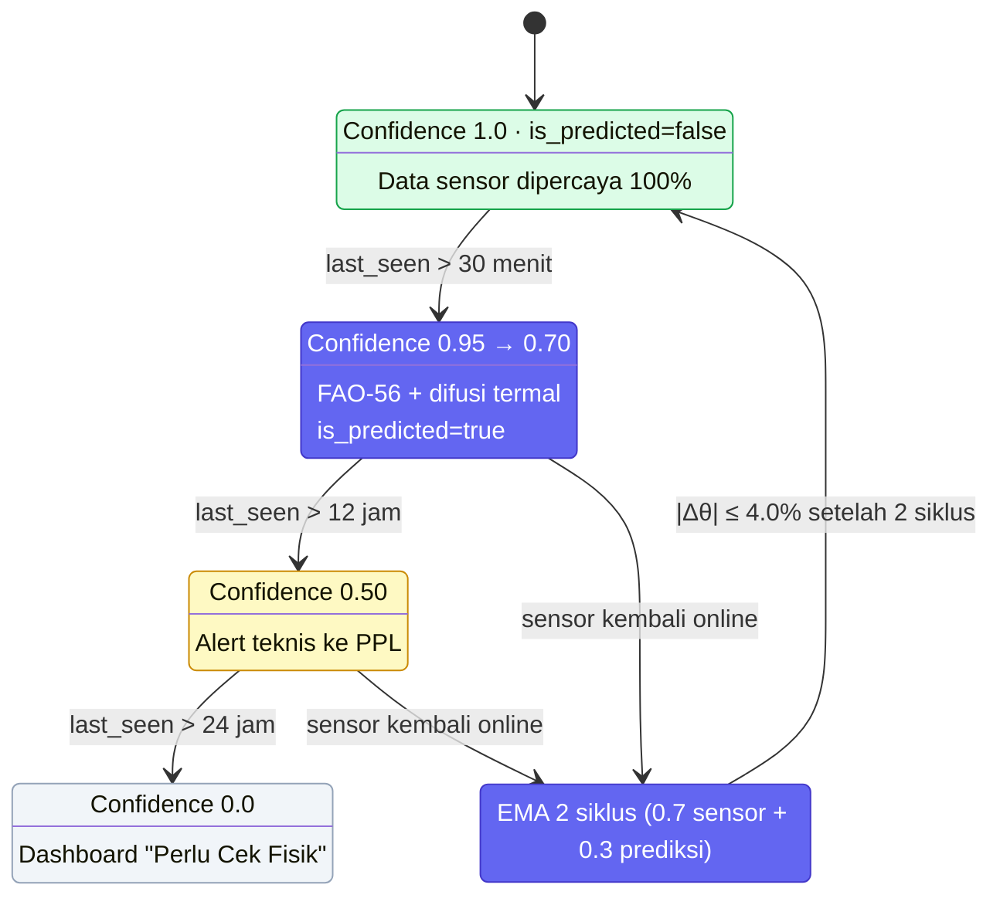

### 9.4 Sampling IoT (15 menit) vs Siklus AI

Node mengirim setiap 15 menit → backend memperbarui state & menjalankan inferensi per paket. Ini menghasilkan **96 titik data/hari/node**, cukup untuk tren AVRI jam-ke-jam tanpa membebani jaringan LoRa.

---

## 10. Closed-Loop Virtual Testbed (Fase TKT 3)

Sesuai ADR 004, pada fase seleksi proposal (batas 31 Okt 2026) seluruh rangkaian dijalankan **100% software** tanpa hardware fisik:

```
┌─────────────────────────────────────────────────────────────────────────────┐
│                 CLOSED-LOOP VIRTUAL TESTBED (SIMULASI TKT 3)                │
│                                                                             │
│ [ VIRTUAL IOT NODE ] (Wokwi CLI / Web)                                      │
│   • ESP32 C++ firmware identik dengan fisik asli                            │
│   • Potensiometer Kelembaban (GPIO34), Suhu DS18B20 (GPIO4), pH (GPIO32)    │
│   • Output: Payload JSON via Virtual MQTT Bridge (Mosquitto :1883)          │
│                    │                                                        │
│                    ▼                                                        │
│ [ DIGITAL TWIN ENGINE ] (Python / SimPy)                                    │
│   • Replay dataset cuaca historis BMKG Lampung Tengah & Lamongan            │
│   • Komputasi neraca air FAO-56 deterministik                               │
│   • Failover engine saat node sengaja diputus (Scenario C)                  │
│                    │                                                        │
│                    ▼                                                        │
│ [ AI PREDICTOR SERVICE ] (FastAPI + LightGBM + PIML)                        │
│   • Evaluasi AVRI (0–100%) & klasifikasi status risiko                      │
│   • Kalkulasi TreeSHAP                                                      │
│                    │                                                        │
│                    ▼                                                        │
│ [ LIVE DASHBOARD & SIMULATOR ] (Next.js 14)                                 │
│   • Grafik telemetri, peta petak, What-If Slider, bot Telegram              │
└─────────────────────────────────────────────────────────────────────────────┘
```

### 10.1 Closed-Loop Testbed (Mermaid)

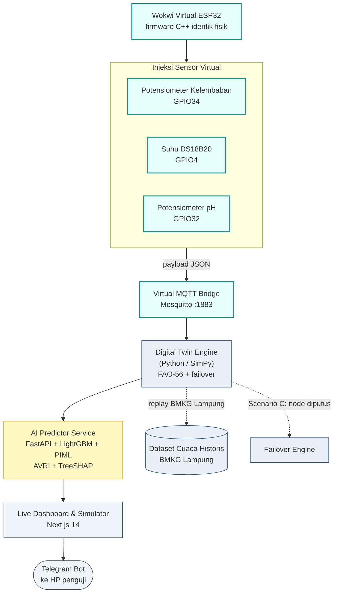

**Struktur file `simulation/wokwi/`:**
1. `diagram.json` — penempatan ESP32, DS18B20, potensiometer moisture & pH, dan modul micro SD.
2. `wokwi.toml` — lokasi binary firmware ELF hasil build.
3. `main.cpp` — **kode firmware yang sama persis** dengan yang akan di-flash ke hardware fisik.

---

## 11. Skenario Uji Demonstrasi Juri (A / B / C)

### Skenario A — Terik Ekstrem (High Volatilization Risk)
- **Injeksi:** Kelembaban 21%, Suhu 34.5°C, pH 7.85.
- **Respon berlapis:**
  1. Wokwi pancarkan payload suhu tinggi, kelembaban rendah.
  2. Digital Twin deteksi defisit air perakaran kritis.
  3. AI hitung **AVRI 78% (Kritis)**.
  4. Dashboard banner merah: *"JANGAN TABUR UREA SEKARANG"*.
  5. Telegram/WA: *"⚠️ RISIKO KRITIS 78%: Jendela aman besok 06:00 WIB"*.

### Skenario B — Hujan Sore (Safe Window Opening)
- **Injeksi:** Hujan 15 mm, Kelembaban 42%, Suhu 26.0°C.
- **Respon:** Digital Twin update neraca air FAO-56 → urease terlarut → AI **AVRI 18% (Aman)** → dashboard hijau, preskripsi *"WAKTU TEPAT MENABUR UREA"*.

### Skenario C — Sensor Dropout (Digital Twin Failover)
- **Injeksi:** Putus koneksi node 2 jam.
- **Respon:** Gateway tandai OFFLINE → Digital Twin failover estimasi via FAO-56 → dashboard tetap grafik kontinu dengan label **`[Est-Simulated]`** tanpa crash (*graceful failover*).

---

## 12. Sinkronisasi Waktu, Sampling & Kadensi

| Proses | Kadensi | Trigger | Domain |
|---|---|---|---|
| Sampling sensor node | Setiap 15 menit | Timer wakeup ESP32 | IoT |
| Transmisi LoRa | Setiap 15 menit | Setelah sampling | IoT |
| Publish MQTT | Per paket diterima | Gateway RX | IoT |
| Ingesti & simpan DB | Per paket | MQTT subscribe | Backend |
| Update state Digital Twin | Per paket (15 mnt) | Step 4 pipeline | Digital Twin |
| Inferensi AI (AVRI) | Per paket | Step 5 pipeline | AI |
| Siaran WebSocket | Per paket | Step 6 pipeline | Backend |
| Sync cuaca BMKG | Setiap 1 jam | Scheduler | Backend |
| Digest harian WA | 05:30 WIB | Scheduler | Backend |
| Reminder logistik H-3 | H-3 fase V8/V12 | Scheduler | Backend |

> **Heartbeat WebSocket:** klien kirim `"ping"` tiap 30 detik; backend balas `"pong"` (`WEBSOCKET_AND_ALERTS.md` §1.1).

---

## 13. Failure Containment Matrix (Domain IoT & Sekitarnya)

| Titik Kegagalan | Respon Otomatis | Dampak ke Pengguna |
|---|---|---|
| Sensor fisik mati / probe tertabrak | Digital Twin FAO-56 imputasi | Label `[Est-Simulated]`; dashboard tetap live |
| Blank spot LoRa / baterai drop | Node tetap deep sleep; failover DT | Grafik kontinu dashed line |
| Model AI error / outlier ekstrem | Fallback aturan fisika (T>32°C & M<25% → AVRI=80%) | Preskripsi tetap aman; warning di log audit |
| Gateway down | Node retry 3x lalu sleep; data celah diimputasi | Data basi hingga gateway pulih |
| Jaringan internet desa putus | Frontend PWA baca cache Service Worker | Petani lihat data terakhir & kalkulator offline |
| Payload gagal sanity check | Buang ke dead-letter; status MALFUNCTION | Admin lihat sensor bermasalah, tidak picu AI |

---

## 14. Keamanan & Integritas Data

| Lapisan | Mekanisme | Sumber |
|---|---|---|
| Batas fisik sensor | `validate_sensor_bounds()` menolak nilai tak wajar | `INGESTION_PIPELINE.md` §2 |
| Isolasi domain | Anti-Corruption Layer (`lora_adapter.py`) | `BOUNDARIES_AND_CONTRACTS.md` §3.1 |
| Provenance BMKG | Checksum SHA-256 pada `data_provenance` | `DATABASE_SCHEMA.md` §4.1 |
| Audit model | Log warning saat fallback fisika aktif | `BOUNDARIES_AND_CONTRACTS.md` §5 |
| Anti-manipulasi | Dataset replay BMKG asli (bukan `random.uniform()`) | ADR 004 |

> **Catatan:** Node tidak menyimpan kredensial/API key. Tidak ada komunikasi keluar langsung dari node (zero attack surface dari lapangan ke internet).

---

## 15. Diagram Sekuens & Topologi Deployment

### 15.1 Sequence Diagram Telemetri End-to-End

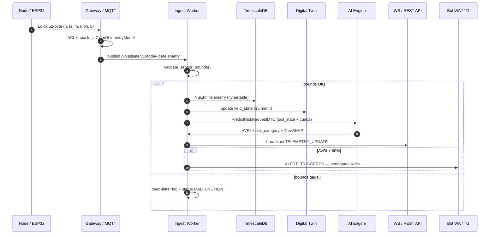

### 15.1.1 Sequence Diagram (Alternatif — Blok ASCII)

```
 Node(ESP32)   Gateway/MQTT   Ingest Worker   TimescaleDB   DigitalTwin   AI Engine   WS/API   Bot(WA/TG)
     │              │              │              │             │            │          │          │
     │ 1. sample+TX │              │              │             │            │          │          │
     ├──LoRa 52B───►│              │              │             │            │          │          │
     │              │ 2. publish   │              │             │            │          │          │
     │              ├─/telemetry──►│              │             │            │          │          │
     │              │              │ 3. validate  │             │            │          │          │
     │              │              │ 4. ACL unpack│             │            │          │          │
     │              │              ├──insert─────►│             │            │          │          │
     │              │              │ 5. update    │             │            │          │          │
     │              │              ├──────────────┼────────────►│            │          │          │
     │              │              │ 6. features  │             │            │          │          │
     │              │              ├──────────────┼─────────────┼───────────►│          │          │
     │              │              │              │             │◄─AVRI+SHAP─┤          │          │
     │              │              │ 7. broadcast │             │            │          │          │
     │              │              ├──────────────┼─────────────┼────────────┼─────────►│          │
     │              │              │ 8. if AVRI>60│             │            │          │          │
     │              │              ├──────────────┼─────────────┼────────────┼──────────┼─────────►│
     │              │              │              │             │            │          │          │
```

### 15.2 Topologi Deployment

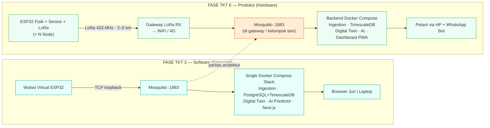

### 15.2.1 Topologi Deployment (Blok ASCII)
────────────────────────────────          ──────────────────────────────────
[ Wokwi Virtual ESP32 ]                    [ ESP32 Fisik + Sensor + LoRa ] × N Node
        │ TCP loopback                              │ LoRa 433 MHz (2–5 km)
        ▼                                           ▼
[ Mosquitto :1883 ]                        [ Gateway LoRa RX → WiFi/4G ]
        ▼                                           ▼
[ Single Docker Compose Stack ]            [ Mosquitto :1883 (di gateway/tani) ]
  • Ingestion Worker                                ▼
  • PostgreSQL + TimescaleDB               [ Backend Docker Compose ]
  • Digital Twin (Python/SimPy)             • Ingestion Worker
  • AI Predictor (FastAPI+LightGBM)         • PostgreSQL + TimescaleDB
  • Next.js Dashboard                        • Digital Twin + AI Predictor
        ▼                                    • Dashboard PWA (VPS/edge)
[ Browser Juri / Laptop ]                           ▼
                                           [ Petani via HP + WhatsApp Bot ]
```

---

## Lampiran A — Matriks Titik Kontrak & PIC

| Kontrak | Batas (Boundary) | PIC Sumber | PIC Tujuan | Format Kunci |
|---|---|---|---|---|
| Kontrak 1 | Hardware ↔ Backend | Hafiiz (IoT) | Syifa (Backend) | LoRa 52-byte → `CleanTelemetryModel` |
| Kontrak 2 | Backend ↔ AI/Twin | Syifa ↔ Aris/Andharu | — | `PredictRiskRequestDTO` ↔ `PredictRiskResponseDTO` |
| Kontrak 3 | Backend ↔ Frontend | Syifa | Syifa | REST `{data,meta,error}` + WS events |

**PIC per domain:**
- **IoT & Embedded Hardware:** Hadi M. Hafiiz Hilmi (Hafiiz) — `iot`
- **Digital Twin Engine:** Andharu Raffi (Andharu) — `digittal-twin`
- **Fullstack Backend & Frontend:** Syifa (Syifa) — `full-stack`
- **AI Engineer & System Architecture (Lead):** Aris Kurniawan (Aris)

---

## Lampiran B — ADR Relevan Domain IoT

| ADR | Keputusan | Relevansi IoT |
|---|---|---|
| ADR 001 | LightGBM + PIML (bukan Deep Learning) | Model kompak ~2MB, bisa jalan di edge (ESP32-S3/ Raspi) |
| ADR 002 | LoRa SX1278 433 MHz | Daya tembus kanopi, bebas lisensi ISM, zero recurring cost |
| ADR 003 | TimescaleDB di atas PostgreSQL | Menyimpan hypertable telemetri partisi 7 hari |
| ADR 004 | Closed-Loop Software Simulation (Wokwi + BMKG) | Firmware identik fisik ↔ simulasi |
| ADR 006 | Isolasi DTO & Anti-Corruption Adapter | `lora_adapter.py` sebagai decoupling buffer |
| ADR 007 | Notifikasi WhatsApp & Telegram utama | Kanal peringatan AVRI Kritis > 60% |

---

## Lampiran C — Referensi Silang Field ↔ Tabel DB ↔ DTO ↔ Fitur AI

| Field LoRa | CleanTelemetry | Kolom `telemetry` | Field DTO AI | Fitur AI |
|---|---|---|---|---|
| `n` | `node_id` | `node_id` | `field_id` (via nodes) | — |
| `ts` | `recorded_at` | `ts` | — | indeks waktu |
| `m` | `moisture_pct` | `moisture` | `soil_state.moisture_pct` | `moisture_pct` (32%) |
| `t` | `soil_temp_c` | `soil_temp` | `soil_state.soil_temp_c` | `soil_temp_c` (28%) |
| `ph` | `ph` | `ph` | `soil_state.ph` | `ph` (16%) |
| `b` | `battery_voltage` | `battery_v` | — | monitoring (bukan fitur) |
| (gateway) | `rssi_dbm` | `rssi_dbm` | — | monitoring sinyal |
| (gateway) | `snr_db` | — | — | monitoring sinyal |
| (derivasi) | `is_predicted` | `is_predicted` | — | penanda failover DT |
| (BMKG) | — | — | `weather_forecast_12h.*` | `air_temp_c`, `wind_speed_ms`, `rain_forecast` |

---

## Lampiran D — Checklist Kepatuhan Boundary Domain IoT

**DO:**
- [x] Kirim hanya payload kompak ≤ 52 byte via LoRa.
- [x] Gunakan pin ADC1 (GPIO 32–39) untuk sensor analog.
- [x] Terapkan deep sleep 15 menit + MOSFET power gate.
- [x] Normalisasi ke `CleanTelemetryModel` melalui `lora_adapter.py`.
- [x] Uji di Wokwi dengan firmware identik fisik.

**DON'T:**
- [ ] Jangan menulis query SQL / koneksi DB di firmware.
- [ ] Jangan menghubungi REST API / internet langsung dari node.
- [ ] Jangan mengubah struktur byte payload LoRa tanpa koordinasi `INTERFACES.md` §1.
- [ ] Jangan memakai pin ADC2 untuk sensor analog.
- [ ] Jangan melampaui anggaran daya 0,07 mAh/siklus.
