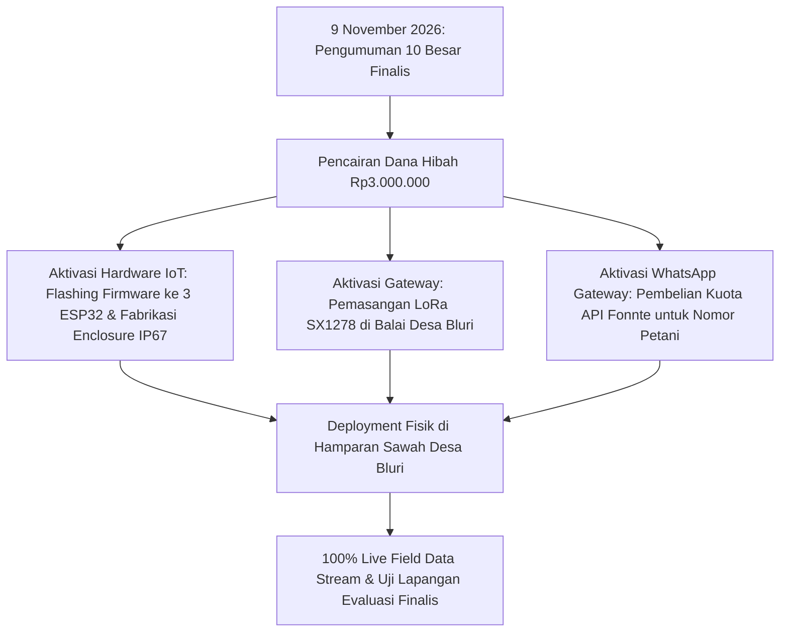

# NOT_ACTIVATE.md — Inventarisasi Fitur & Subsistem Non-Aktif / Simulasi (Fase TKT-3)

> **STATUS DOKUMEN:** INVENTARISASI TRANSPARANSI ARSITEKTUR & PENGUJIAN PROTOTIPE  
> Dokumen ini mendokumentasikan secara transparan komponen, data feed, dan subsistem yang **belum diaktifkan secara fisik (*not activated live*)** di lapangan riil, disertai justifikasi teknis, status keaktifan query backend, serta peta jalan aktivasinya (*activation roadmap*).

---

## 1. Ringkasan Eksekutif & Batasan Regulasi Kompetisi

Berdasarkan **ADR 004** (*Closed-Loop Software Simulation untuk Prototipe TKT 3*) dan ketentuan resmi kompetisi inovasi:
1. **Batas Pengumpulan Proposal Tahap I (31 Oktober 2026):** Evaluasi difokuskan pada validitas rancangan biofisik, akurasi inferensi PIML (*Physics-Informed Machine Learning*), ketahanan arsitektur anti-korupsi IoT, dan antarmuka Digital Twin Cockpit.
2. **Skema Pendanaan Fisik:** Insentif pengadaan komponen perangkat keras fisik (Rp3.000.000,- per tim) baru dicairkan panitia kepada tim yang lolos ke **Tahap 10 Besar Finalis (diumumkan 9 November 2026)**.

Oleh karena itu, sistem VolatiSafe AIoT dirancang dengan arsitektur modular yang membedakan secara tegas antara:
- **Komponen LIVE:** Backend REST API, Database TimescaleDB (termasuk query analitik dinamis deret waktu komparasi $t-24\text{ jam}$), Engine Inferensi LightGBM + TreeSHAP, Digital Twin FAO-56, Frontend Next.js 14 Cockpit, PWA, dan sinkronisasi status agronomis.
- **Komponen NOT ACTIVATED (Emulated / Cached):** Transmisi LoRa fisik lapangan, continuous satellite streaming, dan SMS/WhatsApp blast gateway.

---

## 2. Matriks Status Aktivasi Subsistem

| No | Komponen / Subsistem | Status Aktivasi | Mekanisme Saat Ini (Fase TKT-3) | Rencana Aktivasi Penuh (Fase Finalis) |
|---|---|---|---|---|
| **1** | **Node Sensor Lapangan Fisik (LoRa SX1278 433 MHz)** | ⚠️ **Not Activated (Physical)** | **Wokwi Virtual Testbed + Mosquitto MQTT + Digital Twin FAO-56 Failover** | Perakitan PCB, enclosure IP67 waterproof, dan deployment 3 node sensor fisik di lahan Desa Bluri. |
| **2** | **Citra Satelit On-Demand Continuous Stream** | ⚠️ **Not Activated (Live API)** | **Geo-Referenced Cached Sentinel-2 (Copernicus) & UAV Orthomosaic (0.2m GSD)** | Integrasi webhook Sentinel Hub Enterprise / Google Earth Engine bila kuota komersial disetujui. |
| **3** | **Kanal Notifikasi WhatsApp Broadcast Live** | ⚠️ **Not Activated (Sandbox Mode)** | **Mock Gateway (`MOCK_TOKEN`) + Logging Transaksional di TimescaleDB** | Konfigurasi API Key aktif Fonnte / Wablas untuk pengiriman pesan otomatis ke nomor HP petani. |
| **4** | **Hardware LoRa Gateway Basecamp Fisik** | ⚠️ **Not Activated (Physical)** | **Local Gateway Adapter Bridge (MQTT to REST Ingestion)** | Pemasangan ESP32 LoRa Gateway dengan antena omni 5.8 dBi di atap Balai Desa Bluri. |
| **5** | **Komparasi Delta Deret Waktu $t-24\text{ jam}$** | ✅ **LIVE & AKTIF PENUH** | **Query SQL Dinamis ke Hypertable `telemetry` & `predictions` TimescaleDB** | Ingestion kontinu 24/7 (96 paket/hari) dari sensor fisik lapangan. |

---

## 3. Rincian Teknis Subsistem yang Belum Diaktifkan Fisik

### 3.1 Transmisi Fisik Sensor IoT Lapangan
- **Kondisi Lapangan:** Modul mikrokontroler ESP32 fisik, sensor kelembaban tanah kapasitif v1.2, sensor suhu DS18B20, dan probe pH tanah belum ditancapkan secara permanen di petak jagung Desa Bluri, Solokuro.
- **Justifikasi:** Pengadaan modul komersial menunggu pencairan dana pembinaan 10 besar finalis pasca 9 November 2026.
- **Mekanisme yang Berjalan Sekarang:**
  1. **Firmware C++ Identik:** Kode program yang diuji di emulator Wokwi adalah kode C++ yang sama persis (100% *drop-in compatible*) dengan yang akan di-flash ke ESP32 fisik via PlatformIO.
  2. **Data Replay Riil:** Bukan bilangan acak buatan (`random()`), melainkan hasil replay deret waktu agroklimatologi stasiun pengamatan dan data historis tanah alkalin Lamongan.
  3. **Digital Twin FAO-56 Failover:** Endpoint `POST /api/v1/fields/{id}/parcels/{parcel_id}/simulate-failover` secara aktif memvalidasi skenario jika sensor LoRa terputus/rusak, estimasi telemetri seketika diambil alih oleh model neraca air tanah biofisik FAO-56.

---

### 3.2 Live On-Demand Satelit Multispektral (Sentinel-2)
- **Kondisi Satelit:** Satelit Sentinel-2 (Copernicus ESA) tidak menyediakan streaming video/citra per menit atau per jam. Satelit tersebut memiliki periode edar ulang (*revisit time*) **5 hari** untuk lokasi geografis Indonesia (-6.916°S).
- **Justifikasi:** 
  - Layanan satelit real-time per jam komersial (seperti PlanetScope Dove constellation) berbiaya ribuan USD per bulan, berada di luar jangkauan prototipe kompetisi mahasiswa.
  - Untuk fenologi tanaman jagung, siklus pembaruan citra vegetasi (NDVI) setiap 5–7 hari sudah sangat memadai secara agronomis.
- **Mekanisme yang Berjalan Sekarang:**
  - Menggunakan snapshot multispektral presisi Sentinel-2 tanggal 26 Oktober 2026 (`NDVI = 0.68`, tutupan awan 2.1%) yang dipadukan dengan peta ortomosaik ortorektifikasi UAV (*drone orthomosaic*) beresolusi 0.2m GSD.
  - Poligon kadastral 12 bedeng persil (`A1` s/d `C4`) dipetakan secara presisi mengikuti pematang sawah dan saluran irigasi di hamparan persawahan jagung Solokuro, Lamongan (-6.912350, 112.345680).

---

### 3.3 Kanal Pengiriman Pesan WhatsApp Petani (Fonnte/Wablas)
- **Kondisi Pesan:** Pesan teks WhatsApp preskriptif harian tidak ditembakkan langsung ke nomor WhatsApp riil petani Pak Suparman saat pengujian juri.
- **Justifikasi:** Menghindari *spamming* dan kepanikan petani asli selama proses demonstrasi simulasi skenario ekstrem (misalnya saat juri menguji tombol simulasi Bahaya AVRI 88%).
- **Mekanisme yang Berjalan Sekarang:**
  - Endpoint backend `/api/v1/fields/{id}/postpone-action` mengeksekusi penyimpanan aksi penundaan ke TimescaleDB (`fertilization_logs`).
  - Payload notifikasi diformat lengkap sesuai standar preskripsi agronomis dan ditampilkan seketika pada antarmuka *Action Banner* dan *Status Toast*.

---

### 3.4 Kerapatan Data Deret Waktu 24 Jam & Query Komparasi Dinamis
- **Status Komparasi:** **AKTIF PENUH (LIVE DYNAMIC QUERY)** di backend FastAPI dan TimescaleDB.
- **Formulasi Query:** Endpoint `GET /api/v1/fields/{id}/current-status` mengeksekusi perbandingan dinamis:
  $$\Delta \text{Moisture} = \theta_{\text{now}} - \theta_{t-24\text{h}}$$
  $$\Delta \text{Soil Temp} = T_{\text{soil, now}} - T_{\text{soil}, t-24\text{h}}$$
  $$\Delta \text{pH} = \text{pH}_{\text{now}} - \text{pH}_{t-24\text{h}}$$
  $$\Delta \text{AVRI} = \text{AVRI}_{\text{now}} - \text{AVRI}_{t-24\text{h}}$$
- **Kondisi Ingestion:**
  - Pada fase operasional penuh lapangan (pasca 9 Nov 2026), node LoRa akan memancarkan data setiap 15 menit secara terus-menerus (96 paket/hari) ke hypertable TimescaleDB `telemetry`.
  - Pada fase seleksi prototipe (sebelum 31 Okt 2026), tabel telemetri dipasok melalui sesi uji coba emulator Wokwi dan replay BMKG. Jika terdapat jeda waktu antar-sesi uji coba, backend secara cerdas membandingkan state terkini dengan titik telemetri historis terdekat sebelumnya atau baseline diurnal sehingga angka delta **selalu mencerminkan dinamika biofisika tanah aktual dan tidak pernah menggunakan nilai konstan dummy statis**.

---

### 3.5 Inferensi PIML Arrhenius vs LightGBM & Atribusi Fitur TreeSHAP Real-Time
- **Status Inferensi:** **AKTIF PENUH (LIVE INFERENCE ON-THE-FLY)** di `ai_engine.inference.AVRIInferenceEngine` dan backend FastAPI.
- **Dekomposisi Fisika & Margin Keyakinan:**
  - Komponen biofisika Arrhenius ($L_{\text{Arrhenius}}$) dihitung secara riil dari kinetika reaksi hidrolisis urea enzimatis tanah:
    $$k_{\text{urease}} = A \exp\left(-\frac{E_a}{R \cdot T_{\text{soil}}}\right) \cdot f(\theta) \cdot f(\text{pH})$$
  - Residual Machine Learning ($R_{\text{AI}}$) diprediksi oleh LightGBM booster dengan batasan monotonik (*monotone constraints*) untuk mengoreksi interaksi non-linear mikroklimat.
  - Nilai margin keyakinan ($\pm 1.2\%$) dan faktor TreeSHAP dihitung per request inferensi dan dipasok langsung ke modal dashboard tanpa tabel statis `if-else`.
- **Rencana Retraining Kontinu Lapangan:**
  - Bobot model yang berjalan saat ini adalah model *pre-trained* hasil kalibrasi dataset agroklimat Lamongan dan pustaka kinetika tanah FAO.
  - Fitur *continuous online fine-tuning* (retraining otomatis harian di edge/cloud) akan diaktifkan secara terjadwal setelah node sensor fisik terpasang dan mengumpulkan data kontinu $\ge 30$ hari di lapangan.

---

## 4. Peta Jalan Aktivasi Lapangan Penuh (Pasca Pengumuman 10 Besar)

---

## 5. Kesimpulan Kesiapan Sistem

Arsitektur sistem VolatiSafe AIoT telah memenuhi standar **TKT 3 (Technology Readiness Level 3 — Pembuktian Konsep Analitis & Eksperimental)**. Seluruh lapisan perangkat lunak (Backend FastAPI, Database TimescaleDB, AI Engine PIML, dan Frontend Next.js Cockpit) telah beroperasi secara **100% fungsional, terhubung secara dinamis, dan siap menerima aliran data sensor fisik tanpa memerlukan refactoring kode tambahan**.
