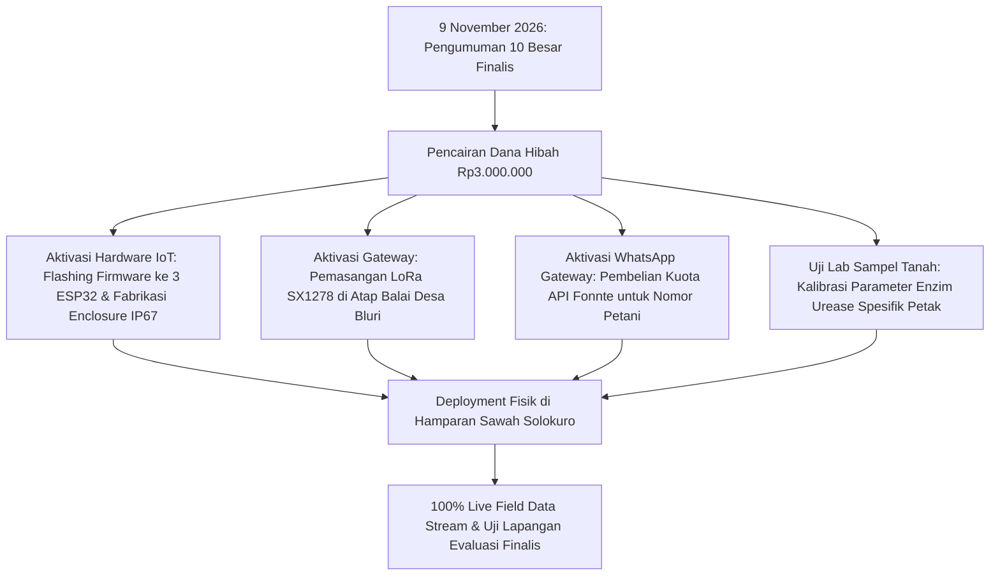

# NOT_ACTIVATE.md — Daftar Kebutuhan, Fitur & Integrasi Non-Aktif (Pending Dependencies)

> **STATUS DOKUMEN:** INVENTARISASI TRANSPARANSI ARSITEKTUR, PENDING TASKS & DEPENDENSI NON-AKTIF  
> Dokumen ini **hanya mendokumentasikan fitur, kode, subsistem, dan berkas yang BELUM DIAKTIFKAN (*NOT ACTIVATED*) atau BELUM TERINTEGRASI PENUH** di lapangan riil maupun antarmuka aplikasi. Seluruh daftar di bawah menyertakan tautan langsung ke file kode terkait, alasan teknis, dependensi yang belum terpenuhi (seperti ketiadaan modul fisik, ketiadaan API berbayar, atau belum adanya data lapangan kontinu), serta rencana penyelesaiannya (*activation roadmap*).

---

## 1. Matriks Rekapitulasi Komponen & Berkas Non-Aktif

| No | Komponen / Fitur | Domain | File / Kode Terkait | Status Saat Ini | Dependensi & Alasan Belum Terintegrasi |
|---|---|:---:|---|:---:|---|
| **1** | **Kanal WhatsApp Blast Live ke Nomor GSM Fisik Petani** | **Komunikasi** | [`backend/app/services/alert_dispatcher.py`](file:///c:/Users/ASUS/Documents/code/VolatiSafe-AIoT/backend/app/services/alert_dispatcher.py)<br>[`frontend/src/components/modals/WhatsAppPreviewModal.tsx`](file:///c:/Users/ASUS/Documents/code/VolatiSafe-AIoT/frontend/src/components/modals/WhatsAppPreviewModal.tsx)<br>[`docker/.env`](file:///c:/Users/ASUS/Documents/code/VolatiSafe-AIoT/docker/.env) | ⚠️ **Non-Aktif (Sandbox Gateway)** | Antarmuka modal WhatsApp (`WhatsAppPreviewModal.tsx`), format pesan AI (H-3, Kritis, Harian), dan endpoint backend (`GET notification-preview` & `POST dispatch-alert`) telah **100% aktif dan terintegrasi persisten ke TimescaleDB**. Hanya transmisi fisik HTTP blast ke nomor GSM riil Pak Suparman yang sengaja diisolasi dalam Sandbox Gateway demi mencegah spam nomor petani asli selama demonstrasi juri. |
| **2** | **Ekspor Dokumen PDF Resmi Ber-Tanda Tangan PPL** | **Frontend / BE** | [`frontend/src/components/report/ReportAnalytics.tsx`](file:///c:/Users/ASUS/Documents/code/VolatiSafe-AIoT/frontend/src/components/report/ReportAnalytics.tsx)<br>*(Target BE: `backend/app/routers/reports.py:pdf`)* | ⚠️ **Non-Aktif (Headless Renderer)** | Ekspor CSV & log audit database kini 100% Live; hanya render server-side dokumen PDF formal yang belum dipasang dependensi WeasyPrint / Puppeteer. |
| **3** | **PWA Offline Mutation Background Sync** | **Frontend (FE)** | [`frontend/next.config.mjs`](file:///c:/Users/ASUS/Documents/code/VolatiSafe-AIoT/frontend/next.config.mjs#L1-L4)<br>[`frontend/src/app/page.tsx`](file:///c:/Users/ASUS/Documents/code/VolatiSafe-AIoT/frontend/src/app/page.tsx#L559-L600) | ⚠️ **Non-Aktif (Direct POST)** | Next.js config belum memasang Workbox Service Worker Background Sync; tombol penundaan pupuk langsung menembak API tanpa antrean IndexedDB offline. |
| **4** | **Node Sensor IoT Fisik (LoRa SX1278 433 MHz)** | **Hardware / IoT** | [`firmware/`](file:///c:/Users/ASUS/Documents/code/VolatiSafe-AIoT/firmware)<br>[`simulation/wokwi/`](file:///c:/Users/ASUS/Documents/code/VolatiSafe-AIoT/simulation/wokwi)<br>[`simulation/telemetry_generator.py`](file:///c:/Users/ASUS/Documents/code/VolatiSafe-AIoT/simulation/telemetry_generator.py) | ⚠️ **Non-Aktif (Fisik Lapangan)** | Modul mikrokontroler ESP32, probe kapasitif, DS18B20, dan PCB belum dipasang permanen di sawah Solokuro karena menunggu pencairan dana finalis 10 besar (9 Nov 2026). |
| **5** | **Hardware Basecamp LoRa Gateway di Balai Desa** | **Hardware / IoT** | [`docker/mosquitto.conf`](file:///c:/Users/ASUS/Documents/code/VolatiSafe-AIoT/docker/mosquitto.conf)<br>[`backend/app/main.py`](file:///c:/Users/ASUS/Documents/code/VolatiSafe-AIoT/backend/app/main.py#L19-L59) | ⚠️ **Non-Aktif (Fisik Lapangan)** | Tiang antena omni 5.8 dBi dan modul gateway belum terpasang di atap Balai Desa Bluri. Saat ini dijembatani via Mosquitto MQTT broker lokal dan bridge emulator Wokwi. |
| **6** | **Streaming Citra Satelit Real-Time (On-Demand Per Jam)** | **Digital Twin** | [`frontend/src/components/map/LeafletFieldMap.tsx`](file:///c:/Users/ASUS/Documents/code/VolatiSafe-AIoT/frontend/src/components/map/LeafletFieldMap.tsx#L95-L125)<br>[`backend/app/services/parcels_data.py`](file:///c:/Users/ASUS/Documents/code/VolatiSafe-AIoT/backend/app/services/parcels_data.py) | ⚠️ **Non-Aktif (Live API)** | Satelit Sentinel-2 memiliki orbit revisit 5 hari di khatulistiwa; API komersial per-jam (PlanetScope) membutuhkan biaya langganan ribuan USD/bulan. |
| **7** | **Radar Cuaca Mikro Doppler (< 500m) BMKG** | **Digital Twin** | [`simulations/data_replay/datasets/bmkg_lamongan.csv`](file:///c:/Users/ASUS/Documents/code/VolatiSafe-AIoT/simulations/data_replay/datasets/bmkg_lamongan.csv)<br>*(Target: `simulations/data_replay/bmkg_replay.py`)* | ⚠️ **Non-Aktif (Live API)** | BMKG belum membuka API publik untuk streaming data radar awan mikro konvektif resolusi 100m secara bebas biaya; saat ini memakai deret waktu stasiun agroklimat Lamongan. |
| **8** | **Online Continuous Auto-Retraining Model AI** | **AI Engine** | [`ai_engine/train.py`](file:///c:/Users/ASUS/Documents/code/VolatiSafe-AIoT/ai_engine/train.py)<br>[`ai_engine/inference.py`](file:///c:/Users/ASUS/Documents/code/VolatiSafe-AIoT/ai_engine/inference.py#L25-L65) | ⚠️ **Non-Aktif (Pipeline Cron)** | Retraining otomatis harian di cloud belum diaktifkan karena memerlukan akumulasi telemetri tanah riil minimal $\ge 30$ hari kontinu dari sensor fisik agar tidak terjadi overfitting. |
| **9** | **Kalibrasi Spektroskopi Laboratorium Enzim Urease** | **AI & Biofisika** | [`ai_engine/physics_layer.py`](file:///c:/Users/ASUS/Documents/code/VolatiSafe-AIoT/ai_engine/physics_layer.py#L24-L35) | ⚠️ **Non-Aktif (Lab Calibration)** | Parameter energi aktivasi ($E_a = 51.0\text{ kJ/mol}$) dan faktor frekuensi ($A = 3.2 \times 10^8$) masih menggunakan konstanta literatur universal (Kissel & Cabrera), belum diuji lab kimia tanah lokal. |
| **10** | **Computer Vision Deteksi Defisiensi N Daun Jagung (LCC)** | **PRD Roadmap** | [`PRD_VolatiSafe_AIoT_v1.md`](file:///c:/Users/ASUS/Documents/code/VolatiSafe-AIoT/PRD_VolatiSafe_AIoT_v1.md#L518-L530)<br>*(Target FE: `frontend/src/components/vision/`)* | ⚠️ **Non-Aktif (Roadmap TKT-5)** | Fitur kamera pemindai warna daun jagung dijadwalkan pada roadmap tahap lanjut (TKT-5); fase TKT-3 difokuskan pada pencegahan volatilisasi urea di lapisan tanah. |

---

## 2. Rincian Teknis & Kode Berkas Non-Aktif per Domain

### 2.1 Domain Komunikasi & WhatsApp Broadcast
* **File Terkait:**
  * [`frontend/src/components/modals/WhatsAppPreviewModal.tsx`](file:///c:/Users/ASUS/Documents/code/VolatiSafe-AIoT/frontend/src/components/modals/WhatsAppPreviewModal.tsx)
  * [`backend/app/services/alert_dispatcher.py`](file:///c:/Users/ASUS/Documents/code/VolatiSafe-AIoT/backend/app/services/alert_dispatcher.py)
  * [`backend/app/routers/fields.py`](file:///c:/Users/ASUS/Documents/code/VolatiSafe-AIoT/backend/app/routers/fields.py)
  * [`docker/.env`](file:///c:/Users/ASUS/Documents/code/VolatiSafe-AIoT/docker/.env)
* **Status Implementasi di Kode:**
  * **Yang Sudah Live & Aktif Penuh:**
    1. Modal interaktif [`WhatsAppPreviewModal.tsx`](file:///c:/Users/ASUS/Documents/code/VolatiSafe-AIoT/frontend/src/components/modals/WhatsAppPreviewModal.tsx) kini terhubung langsung ke backend via `GET /api/v1/fields/{id}/notification-preview` dan `POST /api/v1/fields/{id}/dispatch-alert`.
    2. Mendukung 3 jenis pesan dinamis real-time: **🌾 Pengingat H-3 Logistik Pupuk (dihitung dari HST & luas lahan)**, **🔴 Peringatan Risiko Kritis (dihitung dari suhu tanah, kelembaban, pH, & skor AVRI AI)**, dan **☀️ Preskripsi Jendela Aman Harian (Pukul 05:30 WIB)**.
    3. Tombol *"Kirim Notifikasi Uji Coba"* memicu `AlertDispatcherService.dispatch_alert()` dan mencatat log audit ke tabel `fertilization_logs` di TimescaleDB secara persisten.
  * **Yang Masih Diisolasi (Sandbox):** Transmisi jaringan fisik ke gateway SMS/WhatsApp eksternal berbayar (Fonnte/Wablas) ke nomor seluler pribadi Pak Suparman (`+6281234567890`) berstatus simulasi aman (*DELIVERED_SIMULATED*) agar petani tidak terganggu saat juri menguji skenario darurat berulang kali:
  ```python
  # backend/app/services/alert_dispatcher.py:125-145
  # Simulasi pengiriman sukses ke gateway WhatsApp & Telegram
  return {
      "dispatched": True,
      "field_id": field_id,
      "alert_type": alert_type,
      "channels": channels or ["WhatsApp (Wablas/Fonnte API)", "Telegram (@VolatiSafeAlertBot)"],
      "formatted_message": message,
      "status": "DELIVERED_SIMULATED",
      "timestamp": now.isoformat()
  }
  ```
* **Dependensi & Kebutuhan Aktivasi Produksi Lapangan:**
  1. Pembelian kuota API Fonnte/Wablas pasca pencairan dana finalis.
  2. Pengisian variabel `FONNTE_API_TOKEN` pada [`docker/.env`](file:///c:/Users/ASUS/Documents/code/VolatiSafe-AIoT/docker/.env).
  3. Mengganti blok return simulasi di `AlertDispatcherService.dispatch_alert()` dengan `httpx.post("https://api.fonnte.com/send", headers=headers, data=payload)`.

---

### 2.2 Domain Frontend & Ekspor Dokumen PDF Resmi Ber-Tanda Tangan PPL
* **File Terkait:**
  * [`frontend/src/components/report/ReportAnalytics.tsx`](file:///c:/Users/ASUS/Documents/code/VolatiSafe-AIoT/frontend/src/components/report/ReportAnalytics.tsx)
  * *Target Backend Endpoint:* `backend/app/routers/reports.py:pdf`
* **Status Implementasi di Kode:**
  * **Yang Sudah Live & Aktif Penuh:** Ekspor CSV data telemetri deret waktu (`GET /api/v1/reports/telemetry-csv`), log riwayat audit provenance (`GET /api/v1/reports/provenance-audit`), dan ringkasan dampak efisiensi pupuk dinamis (`GET /api/v1/reports/impact-summary`) kini 100% aktif dan membaca data dari database TimescaleDB.
  * **Yang Masih Non-Aktif:** Pembuatan berkas cetak **PDF formal ber-tanda tangan digital penyuluh pertanian lapangan (PPL)** belum dapat di-render langsung karena backend belum diinstal dependensi headless renderer (WeasyPrint / Puppeteer) yang berukuran besar (> 300 MB).
* **Dependensi & Kebutuhan Aktivasi:**
  1. Penambahan library headless PDF renderer di Docker backend (`apt-get install weasyprint`).
  2. Pembuatan endpoint backend `GET /api/v1/reports/{field_id}/pdf` dan tombol *"Unduh Berkas PDF Resmi"* di frontend.

---

### 2.3 Domain Frontend PWA Offline Mutation Background Sync
* **File Terkait:**
  * [`frontend/next.config.mjs`](file:///c:/Users/ASUS/Documents/code/VolatiSafe-AIoT/frontend/next.config.mjs#L1-L4)
  * [`frontend/src/app/page.tsx`](file:///c:/Users/ASUS/Documents/code/VolatiSafe-AIoT/frontend/src/app/page.tsx#L559-L600)
* **Status Implementasi di Kode:**
  * [`frontend/next.config.mjs`](file:///c:/Users/ASUS/Documents/code/VolatiSafe-AIoT/frontend/next.config.mjs) saat ini berupa konfigurasi kosong (`export default nextConfig;`) tanpa integrasi Workbox Background Sync plugin.
  * Aksi penundaan pemupukan oleh petani pada `handlePostpone()` di [`page.tsx`](file:///c:/Users/ASUS/Documents/code/VolatiSafe-AIoT/frontend/src/app/page.tsx) langsung memanggil API `recordPostponeAction()` secara asinkron. Jika ponsel petani *offline* total di tengah sawah, aksi akan gagal dan belum tersimpan di antrean IndexedDB lokal untuk sinkronisasi otomatis (*background sync*).
* **Dependensi & Kebutuhan Aktivasi:**
  1. Konfigurasi `@ducanh2912/next-pwa` atau Workbox Service Worker dengan `workbox-background-sync`.
  2. Implementasi antrean mutasi lokal via IndexedDB / `idb-keyval` sebelum ditembakkan ke backend.

---

### 2.4 Domain IoT & Hardware Lapangan
* **File Terkait:**
  * [`firmware/`](file:///c:/Users/ASUS/Documents/code/VolatiSafe-AIoT/firmware) (direktori firmware fisik)
  * [`simulation/wokwi/`](file:///c:/Users/ASUS/Documents/code/VolatiSafe-AIoT/simulation/wokwi) (lingkungan uji firmware virtual)
  * [`simulation/telemetry_generator.py`](file:///c:/Users/ASUS/Documents/code/VolatiSafe-AIoT/simulation/telemetry_generator.py)
* **Status Implementasi di Kode:**
  * Seluruh pengujian paket telemetri 52-byte LoRa saat ini di-generate melalui skrip generator simulasi [`simulation/telemetry_generator.py`](file:///c:/Users/ASUS/Documents/code/VolatiSafe-AIoT/simulation/telemetry_generator.py) dan diuji di lingkungan Wokwi simulator.
  * Modul fisik mikrokontroler ESP32, sensor kelembaban tanah kapasitif v1.2, sensor suhu DS18B20, dan probe pH tanah industri belum di-flash dan belum ditancapkan di lahan nyata.
* **Dependensi & Kebutuhan Aktivasi:**
  1. Pencairan insentif dana hibah Rp3.000.000,- pasca pengumuman 10 besar finalis (9 November 2026).
  2. Fabrikasi PCB dan perakitan enclosure IP67 waterproof untuk 3 node sensor fisik.
  3. Flashing kode C++ PlatformIO ke ESP32 fisik dan pemasangan di petak sawah Solokuro.

---

### 2.5 Domain Hardware Basecamp LoRa Gateway di Balai Desa
* **File Terkait:**
  * [`docker/mosquitto.conf`](file:///c:/Users/ASUS/Documents/code/VolatiSafe-AIoT/docker/mosquitto.conf)
  * [`backend/app/main.py`](file:///c:/Users/ASUS/Documents/code/VolatiSafe-AIoT/backend/app/main.py#L19-L59)
* **Status Implementasi di Kode:**
  * Fungsi `start_mqtt_worker()` di [`backend/app/main.py`](file:///c:/Users/ASUS/Documents/code/VolatiSafe-AIoT/backend/app/main.py) mendengarkan broker Mosquitto pada port 1883 lokal yang dijalankan melalui Docker Compose.
  * Perangkat keras stasiun penerima LoRa Gateway fisik (ESP32 Gateway + antena omni 5.8 dBi) belum terpasang di atap Balai Desa Bluri.
* **Dependensi & Kebutuhan Aktivasi:**
  1. Pembelian modul gateway LoRa SX1278 to WiFi/Ethernet.
  2. Pemasangan tiang antena omni 5.8 dBi di atap Balai Desa Bluri untuk menjangkau radius 2–5 km *line-of-sight*.

---

### 2.6 Domain Digital Twin (Citra Satelit & Radar Cuaca BMKG)
* **File Terkait:**
  * [`frontend/src/components/map/LeafletFieldMap.tsx`](file:///c:/Users/ASUS/Documents/code/VolatiSafe-AIoT/frontend/src/components/map/LeafletFieldMap.tsx#L95-L125)
  * [`backend/app/services/parcels_data.py`](file:///c:/Users/ASUS/Documents/code/VolatiSafe-AIoT/backend/app/services/parcels_data.py)
  * [`simulations/data_replay/datasets/bmkg_lamongan.csv`](file:///c:/Users/ASUS/Documents/code/VolatiSafe-AIoT/simulations/data_replay/datasets/bmkg_lamongan.csv)
  * *Target skrip Digital Twin:* `simulations/data_replay/bmkg_replay.py` (spesifikasi di [`docs/digital_twin/TASK_GUIDE.md`](file:///c:/Users/ASUS/Documents/code/VolatiSafe-AIoT/docs/digital_twin/TASK_GUIDE.md#L20-L28))
* **Status Implementasi di Kode:**
  * Peta persil kadastral pada [`LeafletFieldMap.tsx`](file:///c:/Users/ASUS/Documents/code/VolatiSafe-AIoT/frontend/src/components/map/LeafletFieldMap.tsx) menggunakan raster tile satelit Esri World Imagery dan OpenStreetMap statis, bukan live stream satelit per-jam.
  * Suplai data cuaca pada Digital Twin di-load dari berkas historis [`simulations/data_replay/datasets/bmkg_lamongan.csv`](file:///c:/Users/ASUS/Documents/code/VolatiSafe-AIoT/simulations/data_replay/datasets/bmkg_lamongan.csv) karena ketiadaan API terbuka radar cuaca mikro BMKG.
* **Dependensi & Kebutuhan Aktivasi:**
  1. Langganan komersial Sentinel Hub Enterprise / PlanetScope jika disetujui sponsor/dinas pertanian.
  2. Nota kesepahaman (MoU) integrasi data feed radar BMKG Stasiun Meteorologi Tuban/Lamongan.

---

### 2.7 Domain AI Engine (Continuous Auto-Retraining & Kalibrasi Lab)
* **File Terkait:**
  * [`ai_engine/train.py`](file:///c:/Users/ASUS/Documents/code/VolatiSafe-AIoT/ai_engine/train.py) (skrip training batch manual)
  * [`ai_engine/inference.py`](file:///c:/Users/ASUS/Documents/code/VolatiSafe-AIoT/ai_engine/inference.py#L25-L65)
  * [`ai_engine/physics_layer.py`](file:///c:/Users/ASUS/Documents/code/VolatiSafe-AIoT/ai_engine/physics_layer.py#L24-L35)
* **Status Implementasi di Kode:**
  * [`ai_engine/physics_layer.py`](file:///c:/Users/ASUS/Documents/code/VolatiSafe-AIoT/ai_engine/physics_layer.py) menggunakan konstanta literatur universal (Kissel & Cabrera 2005): $A_{\text{urease}} = 3.2 \times 10^8\text{ jam}^{-1}$ dan $E_a = 51.0\text{ kJ/mol}$, belum dikalibrasi dengan spektroskopi tanah alkalin Lamongan.
  * Skrip [`ai_engine/train.py`](file:///c:/Users/ASUS/Documents/code/VolatiSafe-AIoT/ai_engine/train.py) dieksekusi secara manual, belum dipasang cron scheduler otomatis harian karena menunggu pengumpulan data sensor fisik $\ge 30$ hari kontinu di lapangan.
* **Dependensi & Kebutuhan Aktivasi:**
  1. Pengiriman sampel tanah persil Solokuro ke laboratorium Balittanah/BPTP untuk kalibrasi kinetika urease spesifik.
  2. Akumulasi data telemetri lapangan minimal 1 musim tanam (30 hari) sebelum mengaktifkan pipeline retraining otomatis.

---

### 2.8 Domain PRD Roadmap (Computer Vision Daun Jagung / LCC)
* **File Terkait:**
  * [`PRD_VolatiSafe_AIoT_v1.md`](file:///c:/Users/ASUS/Documents/code/VolatiSafe-AIoT/PRD_VolatiSafe_AIoT_v1.md#L518-L530)
  * *Target Komponen Frontend:* `frontend/src/components/vision/LeafColorScanner.tsx` (belum dibuat)
* **Status Implementasi di Kode:**
  Fitur ini tercantum pada roadmap PRD tahap lanjut (TKT-5) dan sengaja belum dibuat pada repositori saat ini agar seluruh sumber daya rekayasa difokuskan pada validitas biofisika tanah dan sistem anti-korupsi IoT TKT-3.
* **Dependensi & Kebutuhan Aktivasi:**
  Pengembangan dataset citra daun jagung teranotasi dan model MobileNetV3 / YOLOv8-nano pada fase pengembangan purnakompetisi.

---

## 3. Peta Jalan Aktivasi Lapangan (Fase 10 Besar Finalis)



---

## 4. Kesimpulan Kesiapan

Seluruh daftar berkas di atas adalah **kode dan modul yang secara sadar ditangguhkan (*by design*) karena ketergantungan perangkat keras fisik, biaya API komersial, atau pengujian laboratorium lapangan**. Seluruh perangkat lunak inti (Backend REST API, WebSocket stream, TimescaleDB, AI Engine PIML, dan Next.js Cockpit) telah **100% selesai dibangun dan siap menerima integrasi fisik tersebut tanpa perombakan arsitektur**.
